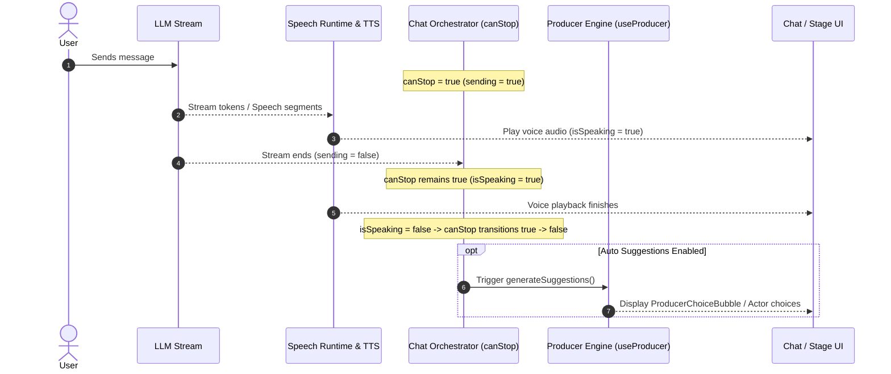

# Design Document: Auto Suggestions (Guided Mode)

## 1. Executive Summary

AIRI currently provides several modes for visual and narrative proactivity:
1. **`image_journal`**: Agent-initiated tool call where the character autonomously chooses to preserve moments or selfies into the persistent image memory ledger.
2. **Autonomous Artistry ("Visual Novel" in Quick Settings)**: Autonomous Director evaluating scene state in the background to render background concept art and illustrations for every scene.
3. **Director Lite / Producer ("Magic Wand" in Composer)**: Interactive response copilot that generates contextual reply suggestions on demand when the user clicks the magic stick button (`i-solar:magic-stick-3-bold-duotone`).
4. **Dating Sim Mode**: An experimental, dormant subsystem attempting to merge visual novel scene generation and Producer branching into a standalone Actor stage. However, Dating Sim suffers from fragile, over-engineered gamestate machinery (Amagami-style intimacy/tension meters, topic action-point budgets, 24h clock, storyline maps, and turn limits).

**Auto Suggestions** bridges this gap. It extracts the core appeal of visual novel branching dialogue—automatic, responsive choice prompts presented to the player at every turn—while discarding the heavy, buggy gamestate machine of Dating Sim.

When Auto Suggestions is enabled, AIRI waits until the character has **completely finished her turn** (defined as the completion of TTS audio playback if voice is enabled, or the completion of LLM token streaming if muted). At that exact moment, AIRI automatically generates the next set of user reply suggestions, immediately presenting them in the chat transcript or stage overlay.

---

## 2. Core Concepts & User Experience

### 2.1 The Turn-Completion Anchor

In a multimodal conversation, an assistant's turn is not over when the LLM emits `[DONE]`. In voice-enabled sessions, the LLM may finish generating text in 1–2 seconds, while TTS audio synthesis and playback continue for another 5–10 seconds.

Auto Suggestions strictly anchors its trigger to the **end of all audio and text output**:
* **With TTS / Voice Enabled**: The trigger fires the moment `airi-speaking-state` reports `nowSpeaking: false` and the audio pipeline drains.
* **With TTS Disabled / Muted**: The trigger fires the moment LLM generation ends (`onAssistantResponseEnd` / `sending: false`).
* **Technical Anchor**: Evaluated reactively via `useChatOrchestratorStore().canStop` (`sending || isSpeaking`), specifically on the falling edge (`true` $\to$ `false`).



### 2.2 The Composer Contract: Non-Destructive Draft Guidance (Option A)

Users often begin drafting thoughts while the character is speaking. Auto Suggestions respects and leverages this behavior:

* **Composer is Empty**: Auto Suggestions generates open-ended, contextual reply options imitating the user's voice and relationship style.
* **Composer has Draft Text**: Auto Suggestions extracts the draft text as `guidance` for the suggestion prompt (e.g. *"Give me suggestions that head in this direction..."*), but **crucially preserves the draft text in the composer**.
* **Outcome**: The user never loses their train of thought. If they like a suggested choice, clicking it replaces the composer; if they prefer their own original text, they can simply hit `Enter` / Send.

### 2.3 Visual Presence & Magic Wand Reference

Auto Suggestions is directly connected to the composer's **Magic Wand** (`i-solar:magic-stick-3-bold-duotone`):
* When Auto Suggestions is **inactive**: The wand retains its standard idle appearance (neutral icon, on-demand click).
* When Auto Suggestions is **active**: The wand displays an armed/active state:
  * Highlighted primary color (`text-primary-500 dark:text-primary-400`).
  * Subtle active indicator dot or glow ring.
  * Clicking the wand while armed still provides immediate user control:
    * If suggestions are currently visible: dismisses them.
    * If composer has text: immediately forces an explicit quick-suggest.
    * If composer is empty: opens the `ProducerGuidanceModal` for manual configuration.

### 2.4 Quick Settings Surface

In the Quick Settings popover (`ChatOptionsCapabilitiesView.vue`), under the **Core Capability** section (alongside *Visual Novel*, *Dreams*, and *Screen Watching*), a dedicated toggle is surfaced:

* **Icon**: `i-solar:magic-stick-3-bold-duotone`
* **Title**: `Auto Suggestions`
* **Subtitle**: `Generates reply choices after each turn`
* **Storage**: `airi:producer:auto-suggestions-enabled` (`boolean`, default: `false`)

---

## 3. Technical Specification

### 3.1 Persistence & Data Catalog

Persisted in `localStorage` under the Producer subsystem key hierarchy (`docs/data-catalog.md` §4.20):

| Key | Type | Default | Scope | Description |
| :--- | :--- | :--- | :--- | :--- |
| `airi:producer:auto-suggestions-enabled` | `boolean` | `false` | Global / LocalStorage | Master toggle for automatic end-of-turn suggestion generation. |

Existing Producer keys leveraged without modification:
* `airi:producer:context-depth` (default `6`): Conversation turn history inspected.
* `airi:producer:suggestion-count` (default `2` or `3`): Number of choices generated.
* `airi:producer:short-replies` (default `true`): Sentence length enforcement.
* `airi:producer:cache-aligned` (default `true`): Prefix-cache alignment for token-efficient LLM calls.

### 3.2 Turn-Completion Watcher Implementation

The turn-completion trigger is encapsulated in a dedicated composable or hook within `stage-ui` / `useProducer`:

```ts
// packages/stage-ui/src/composables/use-auto-suggestions.ts
import { useLocalStorage } from '@vueuse/core'
import { storeToRefs } from 'pinia'
import { ref, watch } from 'vue'

import { useChatOrchestratorStore } from '../stores/chat'
import { useProducer } from './use-producer'

export function useAutoSuggestions(options: {
  getGuidance?: () => string
  onSuggestionsGenerated: (choices: Array<{ title: string, message: string }>) => void
  onGeneratingStateChange?: (loading: boolean) => void
}) {
  const isEnabled = useLocalStorage('airi:producer:auto-suggestions-enabled', false)
  const orchestrator = useChatOrchestratorStore()
  const { canStop, sending } = storeToRefs(orchestrator)
  const { generateSuggestions } = useProducer()

  // Track previous canStop to detect true -> false falling edge
  const wasActive = ref(false)

  watch(canStop, async (active) => {
    if (active) {
      wasActive.value = true
      return
    }

    // Trigger only on falling edge when feature is enabled
    if (wasActive.value && !active && isEnabled.value) {
      wasActive.value = false

      const guidance = options.getGuidance ? options.getGuidance().trim() : ''
      options.onGeneratingStateChange?.(true)

      try {
        const choices = await generateSuggestions({
          guidance: guidance || undefined,
          // Context parameters derived from storage
        })
        options.onSuggestionsGenerated(choices)
      }
      finally {
        options.onGeneratingStateChange?.(false)
      }
    }
    wasActive.value = false
  })

  return { isEnabled }
}
```

### 3.3 Guard Rails & Edge Cases

1. **User Interruption / Stop Action**:
   If the user hits `Stop` (`chatOrchestrator.stop()`), the turn is aborted prematurely. Auto Suggestions suppresses generation when a generation was explicitly stopped or errored (`onGenerationStopped`).
2. **Duplicate Fire Prevention**:
   Between the moment LLM streaming finishes (`sending = false`) and the next audio segment begins playing (`isSpeaking = true`), there can be a 10–50ms micro-gap. The watcher debounces or checks `activeSendHandles` / speech queue status before committing to the turn-end trigger.
3. **Draft Preservation Guarantee**:
   The draft text in `messageInput` is read as a snapshot string; `messageInput.value` is **never mutated or cleared** by the auto-suggestions trigger.
4. **Autonomous Loop Safety**:
   If `airi:producer:auto-send` is active alongside Auto Suggestions, an immediate safeguard prevents infinite self-conversation loops unless the user has explicitly authorized headless auto-play.

---

## 4. Files Touched & Modified

| Subsystem / File | Proposed Role in Auto Suggestions |
| :--- | :--- |
| `packages/stage-layouts/src/components/Layouts/ChatOptions/ChatOptionsCapabilitiesView.vue` | Adds the **Auto Suggestions** toggle in Quick Settings under Core Capabilities. |
| `apps/stage-tamagotchi/src/renderer/components/InteractiveArea.vue` | Integrates the turn-completion watcher, updates Magic Wand visual state, and populates `producerSuggestion` in the chat transcript. |
| `packages/stage-ui/src/components/scenarios/chat/WhisperComposerBar.vue` | Integrates turn-completion watcher and armed wand styling for unified desktop/web/mobile composer bar. |
| `apps/stage-tamagotchi/src/renderer/pages/actor.vue` | Listens for turn-completion on the standalone Actor stage to automatically populate `actorSuggestions` in `WhisperDock`. |
| `packages/stage-ui/src/composables/use-producer.ts` | Exposes normalized suggestion generation helpers and defaults for automated triggers. |
| `docs/data-catalog.md` | Registers `airi:producer:auto-suggestions-enabled` under §4.20. |

---

## 5. Related Architecture Documents

* **[docs/design-chatbox-magic-wand-flow.md](file:///Users/richardpinedo/Projects.nosync/airi/airi_dasilva333/docs/design-chatbox-magic-wand-flow.md)**: Full trace of the Magic Wand button, `ProducerGuidanceModal`, `useProducer.ts`, and `ProducerChoiceBubble.vue`.
* **[docs/design-director-producer-roles.md](file:///Users/richardpinedo/Projects.nosync/airi/airi_dasilva333/docs/design-director-producer-roles.md)**: Role taxonomy separating Director (visual scene evaluation) from Producer (interactive choice generation).
* **[docs/proposal-prefix-cache-alignment.md](file:///Users/richardpinedo/Projects.nosync/airi/airi_dasilva333/docs/proposal-prefix-cache-alignment.md)**: Explains the KV prefix-cache alignment used by `useProducer` to keep suggestion generation fast and cost-effective.
* **[docs/data-catalog.md](file:///Users/richardpinedo/Projects.nosync/airi/airi_dasilva333/docs/data-catalog.md)**: Canonical inventory of persisted storage keys (§4.20 Dating Sim & Producer).
* **[docs/design-dating-sim-gamestate-mechanics.md](file:///Users/richardpinedo/Projects.nosync/airi/airi_dasilva333/docs/design-dating-sim-gamestate-mechanics.md)**: Historical documentation of the legacy Dating Sim engine and choice mechanics.
