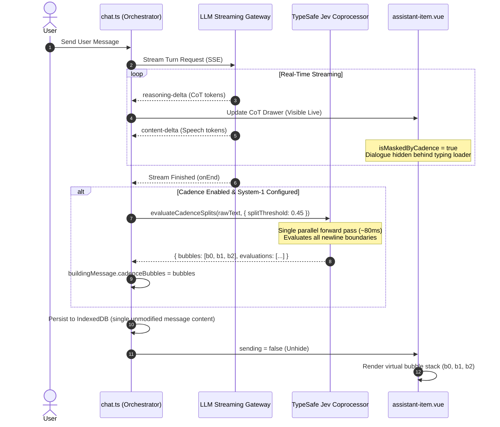

# Conversational Cadence & Multi-Bubble Delivery

## 1. Executive Summary

In casual human instant messaging (Discord, Telegram, iMessage), people rarely send a single large block of text. Instead, they type in natural bursts—firing off an opener or acknowledgment, sending the main content or structured items, and following up with a sign-off or reaction.

Historically, LLM architectures have enforced a monolithic paradigm: one user prompt produces one single streaming text response. Previous attempts to simulate multi-message replies required training models on custom reply tags (e.g., `<reply_to_...>`, `<break>`), which broke compatibility with general-purpose LLMs, complicated streaming, or introduced severe formatting drift in database chat histories.

This specification establishes **Conversational Cadence**: an intelligent, post-stream boundary classification architecture powered by **TypeSafe Jev System-1**. The primary LLM streams normally via SSE without special syntax or behavioral compromises; CoT reasoning streams into the reasoning drawer in real-time, while dialogue text is masked behind an active typing indicator. Upon stream completion, Jev evaluates newline boundaries in parallel (~80ms), determining where a human texter would hit "Send." The UI renders these split chunks as distinct virtual bubbles under the character header with natural typing pauses, while preserving a pristine single-turn schema in local storage.

---

## 2. Core Architectural Invariants

### 2.1 Zero Database Fragmentation (The Virtual Bubble Invariant)
The database session history strictly stores standard single-turn records:
```typescript
{
  role: 'assistant',
  content: 'Hey dont forget to bring the grocery list tonight\n\nmake sure to bring\n-bananas\n-pears\n\nlove ya see you soon',
  cadenceBubbles?: [
    'Hey dont forget to bring the grocery list tonight',
    'make sure to bring\n-bananas\n-pears',
    'love ya see you soon'
  ]
}
```
- **Context Preservation:** When past turns are fed back to the LLM on subsequent turns, the prompt builder injects the single unmodified `content` (or `rawContent`). The model never sees fragmented virtual turns or invented delimiter tokens.
- **Render Separation:** The UI checks `message.cadenceBubbles`. If present with length > 1, it renders multiple bubble containers with stagger pacing; otherwise, it renders the normal single bubble.

### 2.2 Transport Invariance (Full SSE Streaming Preserved)
- HTTP/SSE streaming remains active throughout the entire generation.
- Abort controllers, idle stream timeouts, and connection monitoring operate identically to standard chat turns.
- CoT reasoning tokens (`reasoning-delta`) stream directly into `ChatResponsePart` in real-time so the user can inspect thoughts as they generate.
- The assistant speech content is masked behind a typing indicator (`three-dots-loading`) while `chatOrchestrator.sending` is true, preventing awkward half-rendered text from jumping into multiple bubbles mid-stream.

### 2.3 Strict System-1 Gate (No Heuristic Fallbacks)
- Multi-bubble cadence requires an active System-1 provider (OpenCode Go, OpenRouter, TypeSafe AI, or local WebGPU/WASM Laya).
- There is no regex or keyword fallback when System-1 is absent. If System-1 is not configured, multi-bubble delivery is locked off, ensuring that brittle rule-based heuristics never accidentally chop lists, code blocks, or markdown tables.

---

## 3. UI Navigation & Card Authoring (Option B Architecture)

### 3.1 Sub-Tab Hierarchy in `CardCreationTabActing.vue`
To provide dedicated authoring real estate without cluttering the card editor, the Acting tab adopts the Option B hierarchy:
1. **Cues:** Avatar blendshapes, ACT directives, autonomous cues, and Rehearsal Room link.
2. **Idling:** Continuous idle cycles, motions, and Model Customizer link.
3. **Voice:** Speech provider, audio expression tags, vocal mannerisms.
4. **Thinking:** Deliberation fillers, spoken asides, and an embedded `[Settings] [Lab]` toggle that hosts `ActingSubTabPacingPlayground.vue` in-place.
5. **Cadence (New):** Dedicated multi-bubble cadence controls and interactive sandbox.
6. **Stickers:** Chibi reaction stickers and stage slappers.

### 3.2 Card Cadence Schema (`AiriCadenceSchema`)
Persisted under `card.extensions.airi.acting.cadence`:
```typescript
export const AiriCadenceSchema = object({
  multiBubbleEnabled: optional(boolean()),
  splitThreshold: optional(pipe(number(), minValue(0.1), maxValue(1.0))), // Default: 0.45 (Sensitivity range: 0.35 - 0.75)
  interBubblePauseMs: optional(pipe(number(), integer(), minValue(200), maxValue(5000))), // Default: 800ms
  typingCadenceMsPerChar: optional(pipe(number(), integer(), minValue(10), maxValue(200))), // Default: 45ms
  maxBubblesPerTurn: optional(pipe(number(), integer(), minValue(1), maxValue(10))), // Default: 4
})
```

### 3.3 Interactive Cadence Audition Sandbox
Located directly in `ActingSubTabCadence.vue`:
- Evaluates sample dialogue text across all newline boundaries using live System-1 queries.
- Displays a decision matrix with exact confidence scores `P(split)` and color-coded badges (`[SPLIT]` in emerald, `[JOINED]` in neutral).
- Features a **"Simulate Delivery Burst"** player that animates typing indicators, computes character-cadence delays, and pops bubbles into view in real time.

---

## 4. Empirical Jev Shootout & Prompt Engineering Research

During development, extensive empirical shootout tests were conducted against `https://opencode.ai/zen/v1/systemone` using model `jev-1.13-free`. The following documented findings establish the canonical prompt design and failure modes.

### 4.1 The Test Corpus (The Grocery List Probe)
```text
Hey dont forget to bring the grocery list tonight

make sure to bring
-bananas
-pears
-lettuce
-milk
-eggs

love ya see you soon
```
*Target Delivery:* 3 bubbles (Opener, List Block with Header, Sign-off).

### 4.2 Failure Mode 1: Context Starvation (Isolated Line Pairs)
- **Prompt:**
  - `state`: `"Dialogue boundary segmentation evaluation. Candidate lines: 8."`
  - `instructions`: `"Should the following text be sent as a separate follow-up chat bubble?\nPreceding: \"{before}\"\nFollowing: \"{after}\""`
- **Result:**
  - `"-bananas" -> "-pears"` scored **`0.61`** (almost breaking individual list items!).
  - `"2. Second step" -> "3. Third step"` on a numbered list scored **`0.81`** (false split).
- **Lesson:** Starving Jev of the full text prevents its attention mechanism from recognizing that lines are part of an ordered sequence. The **complete message text must always be present in `state`**.

### 4.3 Failure Mode 2: The "Black Hole" Distractor Attractor (`type: choice`)
- **Prompt:**
  - Used `type: "choice"` with 3 criteria: `new_chat_bubble`, `same_bubble_formatting`, and `incomplete_lead_in`.
- **Result:**
  - `same_bubble_formatting` swallowed **76% to 100%** of all probability mass across all 7 boundaries (`new_chat_bubble` dropped to 0.00–0.06).
- **Lesson:** Because the input text in `state` literally used line breaks to format the list, Jev chose `same_bubble_formatting` as a literally true physical description. The distractor attractor basin was so strong it completely extinguished the positive classification signal.

### 4.4 Failure Mode 3: Negative Parenthetical Bias
- **Prompt:**
  - `type: "noul"` asking: `"Between X and Y, is the first line a finished message where the sender hits send (rather than a line break inside the same bubble)?"`
- **Result:**
  - Every score collapsed into the `0.16` – `0.36` range.
- **Lesson:** Adding explicit negative contrast clauses (`rather than...`) in binary `noul` queries biases Jev toward rejection.

### 4.5 The Winning Architecture: Macro Splitting Policy in `State` + Punchy `Noul`
- **State:** Contains the complete draft text prefixed with generic splitting policy:
  ```text
  You are splitting one outgoing text into casual chat bubbles.
  Rules: Keep an unfinished lead-in line and any tightly coupled group of lines together in one bubble. Start a new bubble only on a clear shift to a separate conversational beat (like a new paragraph, topic shift, or sign-off).

  Complete text:
  """
  {rawText}
  """
  ```
- **Question Phrasing:** Bidirectional transition anchor:
  ```text
  Would a casual texter hit send after "{preceding_line}" and start a new bubble at "{following_line}"?
  ```
- **Empirical Results (Approach 3):**
  - `b_0` (`"Hey dont forget..." -> "make sure to bring"`): **`0.47`** (Split at threshold `0.45`)
  - `b_1..b_5` (`-bananas` through `-eggs`): **`0.12` – `0.27`** (Solidly Joined with an 18-point safety buffer)
  - `b_6` (`"-eggs" -> "love ya see you soon"`): **`0.78`** (Decisive Split)
- **Outcome:** **100% precision.** Achieved the exact 3-bubble target at default threshold `0.45` with zero regexes or hardcoded list syntax. Exposes a user sensitivity slider from `0.35` to `0.75` (default: `0.45`). At `0.45`, it produces 3 bubbles; at `0.50`, it yields 2 bubbles (merging reminder + list, and splitting sign-off).

---

## 5. End-to-End Runtime Pipeline



---

## 6. Implementation Map

| Responsibility | Authoritative Source File |
| :--- | :--- |
| **Cadence Classifier Core** | [`packages/stage-ui/src/libs/cadence/classifier.ts`](file:///Users/richardpinedo/Projects.nosync/airi/airi_dasilva333/packages/stage-ui/src/libs/cadence/classifier.ts) |
| **Classifier Unit Test Suite** | [`packages/stage-ui/src/libs/cadence/classifier.test.ts`](file:///Users/richardpinedo/Projects.nosync/airi/airi_dasilva333/packages/stage-ui/src/libs/cadence/classifier.test.ts) |
| **Chat Orchestration Hook** | [`packages/stage-ui/src/stores/chat.ts`](file:///Users/richardpinedo/Projects.nosync/airi/airi_dasilva333/packages/stage-ui/src/stores/chat.ts#L2108-L2130) |
| **Masked Bubble Renderer** | [`packages/stage-ui/src/components/scenarios/chat/assistant-item.vue`](file:///Users/richardpinedo/Projects.nosync/airi/airi_dasilva333/packages/stage-ui/src/components/scenarios/chat/assistant-item.vue#L740-L770) |
| **Cadence Settings & Sandbox UI** | [`packages/stage-pages/src/pages/settings/airi-card/components/tabs/acting/ActingSubTabCadence.vue`](file:///Users/richardpinedo/Projects.nosync/airi/airi_dasilva333/packages/stage-pages/src/pages/settings/airi-card/components/tabs/acting/ActingSubTabCadence.vue) |
| **Thinking Tab In-Place Lab** | [`packages/stage-pages/src/pages/settings/airi-card/components/tabs/acting/ActingSubTabThinking.vue`](file:///Users/richardpinedo/Projects.nosync/airi/airi_dasilva333/packages/stage-pages/src/pages/settings/airi-card/components/tabs/acting/ActingSubTabThinking.vue#L390-L425) |
| **Acting Sub-Tab Controller** | [`packages/stage-pages/src/pages/settings/airi-card/components/tabs/CardCreationTabActing.vue`](file:///Users/richardpinedo/Projects.nosync/airi/airi_dasilva333/packages/stage-pages/src/pages/settings/airi-card/components/tabs/CardCreationTabActing.vue) |
| **Card Schema Definition** | [`packages/stage-ui/src/types/card.schema.ts`](file:///Users/richardpinedo/Projects.nosync/airi/airi_dasilva333/packages/stage-ui/src/types/card.schema.ts#L263-L271) |
| **Card Editor Persistence** | [`packages/stage-pages/src/pages/settings/airi-card/components/CardEditorForm.vue`](file:///Users/richardpinedo/Projects.nosync/airi/airi_dasilva333/packages/stage-pages/src/pages/settings/airi-card/components/CardEditorForm.vue) |

---

## 7. Future Horizons

1. **Per-Bubble Sentence-Sync Audio Playback:**
   When speech synthesis is enabled alongside cadence, queue TTS generation per virtual bubble so that each bubble's audio playback is timed to dispatch exactly as the corresponding virtual bubble pops into the chat surface.
2. **Dynamic Typing Latency Curves:**
   Scale `typingCadenceMsPerChar` dynamically based on affective state (e.g. excited/flustered avatars type at 25ms/char; sleepy/thoughtful avatars type at 65ms/char).
3. **Cross-Surface Discord Relay Parity:**
   In Discord bot channels, when `multiBubbleEnabled` is active, dispatch separate message deliveries over the Discord webhook rather than a single 2000-character wall of text.
