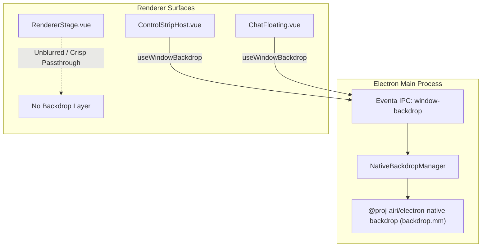
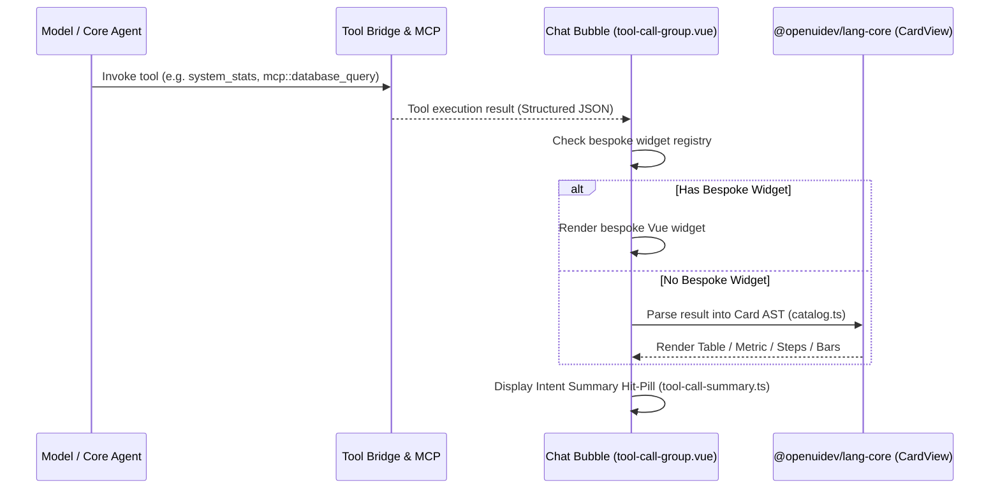

# Design Document: Native Glass Backdrops & Generative OpenUI Tool Cards

> **Status**: Proposed / Architectural Blueprint
> **Originating Upstream PRs**:
> - [PR #3020](https://github.com/moeru-ai/airi/pull/3020): `feat(stage-tamagotchi): add native glass chat backgrounds` (Author: `@luoling8192`)
> - [PR #3033](https://github.com/moeru-ai/airi/pull/3033): `fix(stage-tamagotchi): keep native glass through macOS Space changes` (Author: `@luoling8192`)
> - [PR #3021](https://github.com/moeru-ai/airi/pull/3021): `feat(stage-ui,agents): make cards for tool calls without a widget` (Author: `@chiba233` / `蓝莓🫐`)
> - [PR #3040](https://github.com/moeru-ai/airi/pull/3040): `feat(stage-ui,agents): show what each tool call does and why` (Author: `@chiba233` / `蓝莓🫐`)
> - [PR #3051](https://github.com/moeru-ai/airi/pull/3051): `feat(stage-ui,agents,core-agent): let the model pick a Tabler icon for each tool call` (Author: `@chiba233` / `蓝莓🫐`)
> - [PR #3060](https://github.com/moeru-ai/airi/pull/3060): `feat(stage-tamagotchi): rework the floating chat dock and its styles` (Author: `@chiba233` / `蓝莓🫐`)
> **Target Subsystems**: Desktop Shell (`apps/stage-tamagotchi`), Chat & Generative Presentation (`packages/stage-ui`), Tools Architecture (`packages/stage-ui/src/tools`, `@proj-airi/mcp`)

---

## 1. Executive Summary

Modern desktop agent interaction requires both **high sensory immersion** and **deep operational transparency**:
1. **Sensory Immersion**: The assistant surfaces (Control Strip ribbon, floating chat, contextual drawers) should blend seamlessly into the user's desktop environment through native platform blur and translucency rather than flat opaque rectangles or costly Chromium compositor blur hacks.
2. **Operational Transparency**: When the model invokes autonomous tools or MCP servers that lack dedicated bespoke Vue widgets, the system should not fall back to raw JSON dumps or plain text pills. Instead, it should dynamically synthesize rich, interactive, and structured visual cards (metrics, data tables, comparison bars, sparklines, progress steps, formatted code), accompanied by concise real-time explanations of *what* each tool is doing and *why*.

This document outlines the architectural plan to integrate these capabilities into `dasilva333/airi`, adapting them to our decoupled multi-window desktop architecture (Actor Stage vs. Control Strip) and maintaining full compatibility with our `<|ACTOR|>` multi-actor routing, Two-Layer Memory, and MCP tool registry.

---

## 2. Pillar I: Native Glass Regional Backdrops (PRs #3020, #3033)

### 2.1 Problem & Upstream Breakthrough
In standard Electron applications, creating translucent or frosted-glass windows typically suffers from severe platform limitations:
- Standard CSS `backdrop-filter: blur(...)` requires continuous GPU rasterization by Chromium, increases compositor frame latency, and cannot sample pixels outside the Electron window boundary (i.e. the real desktop wallpaper or underlying applications).
- Electron's built-in `vibrancy` API on macOS is full-window only, preventing complex regional masking, rounded cutout cards, or distinct blur regions on transparent windows.
- Upstream solved this in **PR #3020** by authoring a dedicated native module, `@proj-airi/electron-native-backdrop`, containing an Objective-C++ implementation (`backdrop.mm`) that hooks private macOS CoreAnimation and WindowServer APIs:
  - `CABackdropLayer` and `CAFilter` for native 16pt desktop sampling blur.
  - WindowServer window tags to preserve transparent desktop sampling without window flattening.
  - Independent region lists with per-region coordinates, corner radii, opacity, and clipping paths.
  - In **PR #3033**, maintainer `@luoling8192` resolved a subtle Mission Control glitch where native blur layers disconnected during macOS desktop Space transitions.

### 2.2 Architectural Seam & Fork Decoupling Adaptation
In upstream, native glass was wired into their monolithic desktop chat windows (`pages/chat-floating.vue`, `pages/chat.vue`). In our fork, desktop surfaces are strictly decoupled:
- **Actor Stage (`windows/stage`, `RendererStage.vue`)**: The 3D VRM, Live2D, Spine, or MMD avatar is rendered with a 100% transparent background and mouse passthrough. **The Actor Stage must remain completely free of blur layers** so the character renders crisply directly over desktop windows.
- **Control Strip Ribbon (`windows/main`, `ControlStrip.vue`, `ControlStripHost.vue`)**: The floating desktop ribbon is the primary candidate for native glass. Enabling regional blur behind the Control Strip pill and floating menus elevates the physical feel of the OS companion.
- **Floating Chat & Memory Journal Windows**: Dedicated regional backdrop layers under the composer, message bubble stream, and grounding panels.

### 2.3 Implementation Details
1. **Native Package Integration**: Adopt `packages/electron-native-backdrop` with prebuild / clang scripts scoped to macOS 14+ (`arm64`/`x64`), with no-op shims on Linux/Windows until equivalent DWM / Windows 11 Acrylic hooks are evaluated.
2. **Composable Lifecycle (`use-window-backdrop.ts`)**:
   - Computes element bounding rects multiplied by `window.devicePixelRatio`.
   - Sends batch region updates over Eventa IPC: `window-backdrop:set-regions`.
   - Automatically cleans up on unmount or window hide/close events.
3. **Safety Fallback**: If native backdrop initialization fails or private APIs change on a future macOS release, the composable leaves the CSS fallback (`bg-neutral-900/80 backdrop-blur-md`) active without throwing.

---

## 3. Pillar II: Generative OpenUI Tool Cards & Intent Explanations (PRs #3021, #3040)

### 3.1 Problem & Upstream Breakthrough
When an AI assistant executes tools, tool responses typically take two extremes:
1. Hardcoded Vue components that only work for built-in tools (e.g. Weather, Timer).
2. Raw JSON or plain strings dumped into chat bubbles, forcing the user to decipher structured payloads.

Upstream solved this in **PR #3021** and **PR #3040** by integrating `@openuidev/lang-core` (0.4.1):
- **Dynamic Program Parsing**: Instead of executing untrusted client JS, `@openuidev/lang-core` parses a declarative layout program returned by the LLM or tool synthesizer into safe AST representations.
- **Rich Card Catalog**:
  - `Table`: Sortable tabular data with column headers and cell formatting.
  - `Metric / Numbers`: High-contrast KPIs with change indicators.
  - `Bars & Line Graphs`: Lightweight responsive trend charts and distribution bars.
  - `Progress & Steps`: Multi-phase execution stages and checklist bars.
  - `Code`: Syntax-highlighted snippets with copy actions.
- **Intent Explanations ([PR #3040](https://github.com/moeru-ai/airi/pull/3040))**:
  - Introduces `tool-call-summary.ts` and `hit-pill.vue`.
  - Parses tool execution parameters and model rationale to produce human-readable status lines (e.g., *"Searching memories for 'favorite food' (filter: 7 days)"*).

### 3.2 Architectural Seam & Fork Decoupling Adaptation
In upstream, PR #3021 directly modified `chat.ts` and `chat-orchestrator-runtime.ts`, adding a new `card` message slice to the global store.
**In our fork, we must avoid polluting core cognitive files (`chat.ts`, `llm.ts`)**:
- Our fork possesses extensive, custom cognitive logic in `chat.ts` (`<|ACTOR|>` multi-actor routing, Two-Layer Memory injections, Autonomous Director loops).
- **Decoupled Card Strategy**:
  - Rather than modifying `chat.ts` contracts, we treat Generative Tool Cards as a **pure rendering adapter** within the Chat Transcript subsystem (`packages/stage-ui/src/components/scenarios/chat/components/tool-call-group.vue` and `reply-card.vue`).
  - When a tool returns structured JSON (whether from built-in tools, custom scripts, or external MCP servers via `airi-mcp-integration`), the tool call renderer checks for a dedicated widget. If absent, it feeds the payload through the OpenUI card evaluator (`libs/cards/catalog.ts`), rendering the card seamlessly in the chat bubble.

---

## 4. Pillar III: Model-Selected Dynamic Tool Icons & Tabler Assets (PR #3051)

### 4.1 Problem & Upstream Breakthrough
While intent summaries ([PR #3040](https://github.com/moeru-ai/airi/pull/3040)) clarify *what* a tool is doing, every generic tool invocation or MCP call without an explicit custom icon previously fell back to the same generic magic wand icon.

In **PR #3051**, `@chiba233` (`蓝莓🫐`) solved this by enabling the LLM to choose contextual icons on the fly:
- **`call_icon` Invocations**: Alongside `call_summary`, the model provides a secondary argument: up to three Tabler outline icon names (`i-tabler-*`) ranked by relevance to what the specific call is doing (e.g. `['cloud-download', 'arrow-down', 'download']` for file downloads).
- **Zero Runtime Request Overhead**: Rather than downloading SVG assets at runtime, icons are backed by `@iconify-json/tabler`. The chat row and hit-pill dynamically replace the `--un-icon` CSS mask value on the existing icon container, preserving exact dimensions, color themes, and hover transitions.
- **Card Asset Discovery & Safety**: Generative OpenUI cards are permitted to display Tabler icons. A built-in discovery tool (`builtIn_searchIcons`) allows the card synthesis model to query icon names by semantic keywords, while the card validator strictly rejects arbitrary or unverified icon names.

### 4.2 Architectural Seam & Fork Decoupling Adaptation
In upstream, PR #3051 directly modified `stores/chat.ts`, `stores/ai/chat-llm/llm.ts`, and core agent stream options (`providerTools`).
**In our fork, we preserve cognitive pipeline purity**:
- **Argument Stripping**: Like `call_summary`, `call_icon` is parsed and stripped before the tool receives its arguments. Core cognitive stores (`chat.ts`) remain free of icon selection churn.
- **Presentation Layer Seam**: Icon resolution is confined strictly to the rendering components ([`tool-call-group.vue`](file:///Users/richardpinedo/Projects.nosync/airi/airi_dasilva333/packages/stage-ui/src/components/scenarios/chat/tool-call-group.vue) and [`hit-pill.vue`](file:///Users/richardpinedo/Projects.nosync/airi/airi_dasilva333/packages/stage-ui/src/components/scenarios/chat/components/hit-pill.vue)).
- **Fallback Hierarchy**:
  1. Valid model-selected Tabler icon (`i-tabler-<name>`).
  2. Registered tool default icon from our built-in registry (`airi-tool-registry-builtin-tools`).
  3. Category default (e.g., generic MCP tool or Bash terminal).

---

## 5. Pillar IV: Floating Dock Ergonomics & Dynamic Backdrop Gating (PR #3060)

### 5.1 Problem & Upstream Breakthrough
In **PR #3060**, `@chiba233` (`蓝莓🫐`) addresses usability friction and visual polish in the desktop floating chat shell:
- **Dynamic Backdrop Gating (`useWindowBackdrop` with `enabled` toggle)**: Previously, once a surface mounted with `useWindowBackdrop`, its native blur region remained static. When a transient message feed or hover overlay faded out, the blur rectangle persisted over the wallpaper, creating an unsightly "ghost smudge". PR #3060 adds an `enabled` reactive switch to `useWindowBackdrop`, dynamically deregistering the native backdrop region when the message feed is disabled or hidden.
- **Floating Dock Unification & Hourglass Island**: Consolidates disparate floating styles into a unified dock. The message feed becomes an integrated toggle within the dock rather than an awkward window placement mode. When enabled, a spring-animated "hourglass island" pops out beside the dock, exposing message hiding controls and auto-fade preferences.
- **Edge-Border Resizing (`window-resize-border.vue`)**: Replaces the bulky floating resize grip corner with edge and corner resize handles across the window boundary, complete with a visual border flash animation on window focus/drag.
- **Pointer Click-Through Coordination (`data-takes-pointer`)**: Ensures click-through transparency over unpainted glass while reliably intercepting pointer events over interactive dock controls.

### 5.2 Architectural Seam & Fork Decoupling Adaptation
- **Decoupled Stage Invariant**: In upstream, PR #3060 introduces an "attached to character" mode that docks the chat window to upstream's monolithic character window. In `dasilva333/airi`, the desktop is cleanly decoupled into the **Actor Stage** (`windows/stage`) and the **Control Strip** (`windows/main`).
- **Selective Porting Strategy**:
  1. **Adopt Dynamic Backdrop Gating**: The `useWindowBackdrop({ enabled })` toggle is immediately valuable for our Control Strip floating palettes and contextual transcript windows to ensure faded overlays cleanly clear their native blur layers.
  2. **Adopt Edge Resizing & Visual Borders**: `window-resize-border.vue` and edge resize event handling provide clean utility for any desktop sub-windows without cluttering the UI with corner drag handles.
  3. **Reject Monolithic Window Attachment**: Do not couple floating chat positions to `RendererStage.vue`. The Actor Stage remains purely an avatar presentation surface.

---

## 6. Integration Roadmap for dasilva333/airi

| Phase | Milestone | Scope / Target Files | Risk / Divergence Guard |
| :--- | :--- | :--- | :--- |
| **Phase 1: Native Backdrop Layer** | Port `@proj-airi/electron-native-backdrop` and desktop Eventa bridge | `packages/electron-native-backdrop/`, `apps/stage-tamagotchi/src/main/services/electron/window-backdrop.ts` | Strictly isolate to desktop main process. Ensure `RendererStage.vue` is excluded from backdrop blur. |
| **Phase 2: Floating UI Vibrancy & Gating** | Wire `useWindowBackdrop` with `enabled` gating into Control Strip and floating chat shell (PR #3060) | `apps/stage-tamagotchi/src/renderer/composables/use-window-backdrop.ts`, `ControlStripHost.vue`, `chat-floating.vue` | Maintain graceful CSS fallback when native module is unavailable; dynamically disable blur when feeds fade. |
| **Phase 3: OpenUI Core & Card Catalog** | Add `@openuidev/lang-core` and card presentation primitives | `packages/stage-ui/src/libs/cards/`, `card-view.vue`, `catalog.ts` | Ensure zero telemetry in `@openuidev/lang-core` (verify `allowBuilds: false` in pnpm). |
| **Phase 4: Tool Intent Summaries** | Implement `tool-call-summary.ts` and upgrade chat hit-pills | `packages/stage-ui/src/components/scenarios/chat/components/hit-pill.vue`, `tool-call-summary.ts` | Keep pure: no direct mutations to Pinia `chat.ts` store state. |
| **Phase 5: Dynamic Tabler Tool Icons** | Add `@iconify-json/tabler`, implement `libs/tabler-icons.ts` and `--un-icon` mask replacement | `packages/stage-ui/src/libs/tabler-icons.ts`, `tool-call-group.vue`, `hit-pill.vue`, `tools/search-icons.ts` | Strip `call_icon` before tool dispatch; confine dynamic icon masking strictly to presentation components. |
| **Phase 6: Edge Resizing & Dock Ergonomics** | Port `window-resize-border.vue` and edge handle coordination (PR #3060) | `apps/stage-tamagotchi/src/renderer/components/window-resize-border.vue`, `use-chat-floating-click-through.ts` | Keep decoupled from Actor Stage; preserve independent Control Strip ribbon positioning. |

---

## 7. Architectural Verification & Invariants

1. **Window-Stage Purity Invariant**: `RendererStage.vue` must remain 100% transparent. Native blur must never sample behind the 3D/Live2D model's mesh or avatar bounds.
2. **Cognitive Seam Invariant**: Card rendering must be presentation-only. Do not inject artificial `card` message slices into IndexedDB chat session transcripts; transcripts store standard tool call events, which are rendered on the fly.
3. **MCP Parity**: Any MCP tool called via `airi-mcp-integration` should automatically benefit from generative card rendering without authoring bespoke Vue components.
4. **Zero-Smudge Invariant (PR #3060)**: When a translucent or floating overlay is hidden or fades to opacity 0, its native backdrop blur region must be immediately disabled via `useWindowBackdrop({ enabled: false })` to avoid ghost blur artifacts on the desktop.
