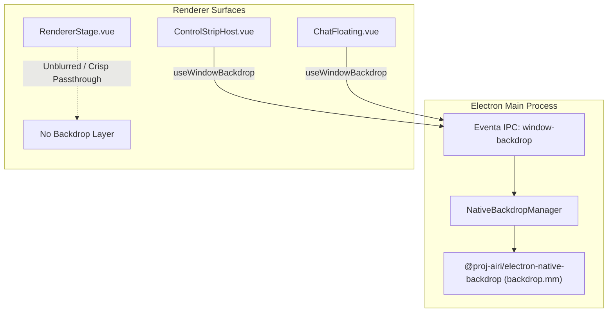
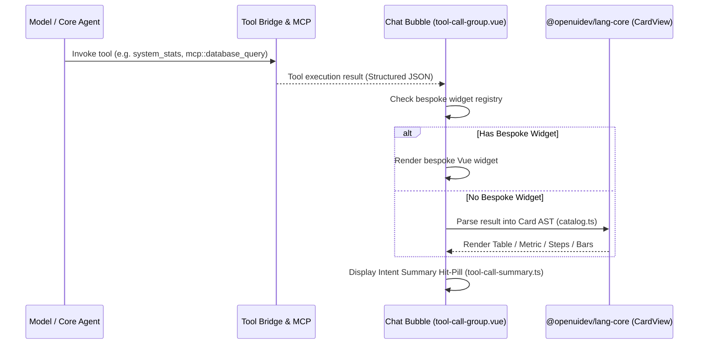

# Design Document: Native Glass Backdrops & Generative OpenUI Tool Cards

> **Status**: Proposed / Architectural Blueprint
> **Originating Upstream PRs**:
> - [PR #3020](https://github.com/moeru-ai/airi/pull/3020): `feat(stage-tamagotchi): add native glass chat backgrounds` (Author: `@luoling8192`)
> - [PR #3033](https://github.com/moeru-ai/airi/pull/3033): `fix(stage-tamagotchi): keep native glass through macOS Space changes` (Author: `@luoling8192`)
> - [PR #3021](https://github.com/moeru-ai/airi/pull/3021): `feat(stage-ui,agents): make cards for tool calls without a widget` (Author: `@chiba233` / `蓝莓🫐`)
> - [PR #3040](https://github.com/moeru-ai/airi/pull/3040): `feat(stage-ui,agents): show what each tool call does and why` (Author: `@chiba233` / `蓝莓🫐`)
> **Target Subsystems**: Desktop Shell (`apps/stage-tamagotchi`), Chat & Generative Presentation (`packages/stage-ui`), Tools Architecture (`packages/stage-ui/src/tools`, `@proj-airi/mcp`)

---

## 1. Executive Summary

Modern desktop agent interaction requires both **high sensory immersion** and **deep operational transparency**:
1. **Sensory Immersion**: The assistant surfaces (Control Strip ribbon, floating chat, contextual drawers) should blend seamlessly into the user's desktop environment through native platform blur and translucency rather than flat opaque rectangles or costly Chromium compositor blur hacks.
2. **Operational Transparency**: When the model invokes autonomous tools or MCP servers that lack dedicated bespoke Vue widgets, the system should not fall back to raw JSON dumps or plain text pills. Instead, it should dynamically synthesize rich, interactive, and structured visual cards (metrics, data tables, comparison bars, sparklines, progress steps, formatted code), accompanied by concise real-time explanations of *what* each tool is doing and *why*.

This document outlines the architectural plan to integrate these capabilities into `dasilva333/airi`, adapting them to our decoupled multi-window desktop architecture (Actor Stage vs. Control Strip) and maintaining full compatibility with our `<|ACTOR|>` multi-actor routing, Two-Layer Memory, and MCP tool registry.

---

## 2. Pillar I: Native Glass Regional Backdrops (PRs #3020, #3033)

### 2.1 Problem & Upstream Breakthrough
In standard Electron applications, creating translucent or frosted-glass windows typically suffers from severe platform limitations:
- Standard CSS `backdrop-filter: blur(...)` requires continuous GPU rasterization by Chromium, increases compositor frame latency, and cannot sample pixels outside the Electron window boundary (i.e. the real desktop wallpaper or underlying applications).
- Electron's built-in `vibrancy` API on macOS is full-window only, preventing complex regional masking, rounded cutout cards, or distinct blur regions on transparent windows.
- Upstream solved this in **PR #3020** by authoring a dedicated native module, `@proj-airi/electron-native-backdrop`, containing an Objective-C++ implementation (`backdrop.mm`) that hooks private macOS CoreAnimation and WindowServer APIs:
  - `CABackdropLayer` and `CAFilter` for native 16pt desktop sampling blur.
  - WindowServer window tags to preserve transparent desktop sampling without window flattening.
  - Independent region lists with per-region coordinates, corner radii, opacity, and clipping paths.
  - In **PR #3033**, maintainer `@luoling8192` resolved a subtle Mission Control glitch where native blur layers disconnected during macOS desktop Space transitions.

### 2.2 Architectural Seam & Fork Decoupling Adaptation
In upstream, native glass was wired into their monolithic desktop chat windows (`pages/chat-floating.vue`, `pages/chat.vue`). In our fork, desktop surfaces are strictly decoupled:
- **Actor Stage (`windows/stage`, `RendererStage.vue`)**: The 3D VRM, Live2D, Spine, or MMD avatar is rendered with a 100% transparent background and mouse passthrough. **The Actor Stage must remain completely free of blur layers** so the character renders crisply directly over desktop windows.
- **Control Strip Ribbon (`windows/main`, `ControlStrip.vue`, `ControlStripHost.vue`)**: The floating desktop ribbon is the primary candidate for native glass. Enabling regional blur behind the Control Strip pill and floating menus elevates the physical feel of the OS companion.
- **Floating Chat & Memory Journal Windows**: Dedicated regional backdrop layers under the composer, message bubble stream, and grounding panels.

### 2.3 Implementation Details
1. **Native Package Integration**: Adopt `packages/electron-native-backdrop` with prebuild / clang scripts scoped to macOS 14+ (`arm64`/`x64`), with no-op shims on Linux/Windows until equivalent DWM / Windows 11 Acrylic hooks are evaluated.
2. **Composable Lifecycle (`use-window-backdrop.ts`)**:
   - Computes element bounding rects multiplied by `window.devicePixelRatio`.
   - Sends batch region updates over Eventa IPC: `window-backdrop:set-regions`.
   - Automatically cleans up on unmount or window hide/close events.
3. **Safety Fallback**: If native backdrop initialization fails or private APIs change on a future macOS release, the composable leaves the CSS fallback (`bg-neutral-900/80 backdrop-blur-md`) active without throwing.

---

## 3. Pillar II: Generative OpenUI Tool Cards & Intent Explanations (PRs #3021, #3040)

### 3.1 Problem & Upstream Breakthrough
When an AI assistant executes tools, tool responses typically take two extremes:
1. Hardcoded Vue components that only work for built-in tools (e.g. Weather, Timer).
2. Raw JSON or plain strings dumped into chat bubbles, forcing the user to decipher structured payloads.

Upstream solved this in **PR #3021** and **PR #3040** by integrating `@openuidev/lang-core` (0.4.1):
- **Dynamic Program Parsing**: Instead of executing untrusted client JS, `@openuidev/lang-core` parses a declarative layout program returned by the LLM or tool synthesizer into safe AST representations.
- **Rich Card Catalog**:
  - `Table`: Sortable tabular data with column headers and cell formatting.
  - `Metric / Numbers`: High-contrast KPIs with change indicators.
  - `Bars & Line Graphs`: Lightweight responsive trend charts and distribution bars.
  - `Progress & Steps`: Multi-phase execution stages and checklist bars.
  - `Code`: Syntax-highlighted snippets with copy actions.
- **Intent Explanations ([PR #3040](https://github.com/moeru-ai/airi/pull/3040))**:
  - Introduces `tool-call-summary.ts` and `hit-pill.vue`.
  - Parses tool execution parameters and model rationale to produce human-readable status lines (e.g., *"Searching memories for 'favorite food' (filter: 7 days)"*).

### 3.2 Architectural Seam & Fork Decoupling Adaptation
In upstream, PR #3021 directly modified `chat.ts` and `chat-orchestrator-runtime.ts`, adding a new `card` message slice to the global store.
**In our fork, we must avoid polluting core cognitive files (`chat.ts`, `llm.ts`)**:
- Our fork possesses extensive, custom cognitive logic in `chat.ts` (`<|ACTOR|>` multi-actor routing, Two-Layer Memory injections, Autonomous Director loops).
- **Decoupled Card Strategy**:
  - Rather than modifying `chat.ts` contracts, we treat Generative Tool Cards as a **pure rendering adapter** within the Chat Transcript subsystem (`packages/stage-ui/src/components/scenarios/chat/components/tool-call-group.vue` and `reply-card.vue`).
  - When a tool returns structured JSON (whether from built-in tools, custom scripts, or external MCP servers via `airi-mcp-integration`), the tool call renderer checks for a dedicated widget. If absent, it feeds the payload through the OpenUI card evaluator (`libs/cards/catalog.ts`), rendering the card seamlessly in the chat bubble.

---

## 4. Integration Roadmap for dasilva333/airi

| Phase | Milestone | Scope / Target Files | Risk / Divergence Guard |
| :--- | :--- | :--- | :--- |
| **Phase 1: Native Backdrop Layer** | Port `@proj-airi/electron-native-backdrop` and desktop Eventa bridge | `packages/electron-native-backdrop/`, `apps/stage-tamagotchi/src/main/services/electron/window-backdrop.ts` | Strictly isolate to desktop main process. Ensure `RendererStage.vue` is excluded from backdrop blur. |
| **Phase 2: Floating UI Vibrancy** | Wire `useWindowBackdrop` into Control Strip and floating chat shell | `apps/stage-tamagotchi/src/renderer/composables/use-window-backdrop.ts`, `ControlStripHost.vue`, `chat-floating.vue` | Maintain graceful CSS fallback when native module is unavailable. |
| **Phase 3: OpenUI Core & Card Catalog** | Add `@openuidev/lang-core` and card presentation primitives | `packages/stage-ui/src/libs/cards/`, `card-view.vue`, `catalog.ts` | Ensure zero telemetry in `@openuidev/lang-core` (verify `allowBuilds: false` in pnpm). |
| **Phase 4: Tool Intent Summaries** | Implement `tool-call-summary.ts` and upgrade chat hit-pills | `packages/stage-ui/src/components/scenarios/chat/components/hit-pill.vue`, `tool-call-summary.ts` | Keep pure: no direct mutations to Pinia `chat.ts` store state. |

---

## 5. Architectural Verification & Invariants

1. **Window-Stage Purity Invariant**: `RendererStage.vue` must remain 100% transparent. Native blur must never sample behind the 3D/Live2D model's mesh or avatar bounds.
2. **Cognitive Seam Invariant**: Card rendering must be presentation-only. Do not inject artificial `card` message slices into IndexedDB chat session transcripts; transcripts store standard tool call events, which are rendered on the fly.
3. **MCP Parity**: Any MCP tool called via `airi-mcp-integration` should automatically benefit from generative card rendering without authoring bespoke Vue components.
