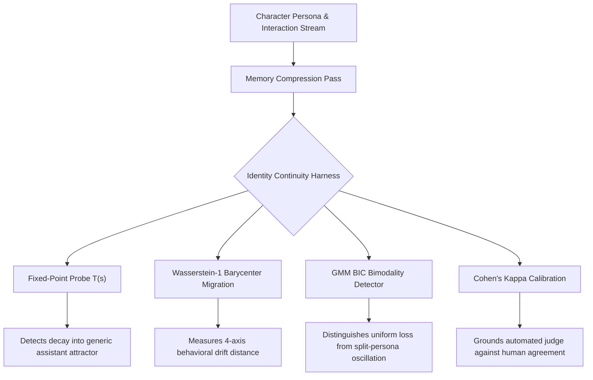

# Proposal: Behavioral Identity Continuity & Persona Drift Evaluation

> **Location**: `docs/memory_lab/proposal-identity-continuity-and-persona-drift-eval.md`
> **Status**: Proposed / Evaluation Architecture RFC
> **Originating Upstream PR**: [PR #3000](https://github.com/moeru-ai/airi/pull/3000): `feat(memory-eval): add identity-continuity evaluation package` (Author: `@RUI-debug769`)
> **Target Subsystems**: Memory Lab, Eight Pillars Architecture, Cognitive & Consciousness Benchmarking (`docs/memory_lab/`, `packages/stage-ui/src/stores/memory*`)

---

## 1. Motivation: The "LoCoMo F1" Blindspot

In the AIRI Memory Lab, benchmarking has historically centered on **LoCoMo** (Long-Context Conversational Memory) methodology: measuring factual retrieval accuracy, entity extraction, and multi-hop question answering via **LoCoMo F1 score** (see [`evaluation-and-benchmarking-methodology.md`](./evaluation-and-benchmarking-methodology.md) and [`LoCoMo-Pass10-Peer-Review.md`](./LoCoMo-Pass10-Peer-Review.md)).

While LoCoMo F1 is vital for verifying whether the retrieval engine (Orama, hybrid BM25 + embeddings, 5W extraction) can pinpoint past episodic facts, it suffers from a critical architectural blindspot:

> **The Persona Drift Paradox**:
> A model can achieve a pristine **98% LoCoMo F1 score** by accurately retrieving that the user visited Kyoto on Day 4, while simultaneously undergoing **catastrophic identity collapse**—reverting to a sterile, sycophantic ChatGPT assistant, abandoning its verbal tics, contradicting its core ethical boundaries, or splitting into an incoherent blend of contradictory personalities.

Upstream **PR #3000** introduces a self-contained, mathematically rigorous evaluation package (`@proj-airi/memory-eval`) designed specifically to measure whether a character **remains the same character** over long conversations and successive memory compression cycles.

This proposal evaluates adopting and adapting PR #3000's methodology inside the AIRI Memory Lab as a complementary benchmark alongside LoCoMo F1.

---

## 2. Mathematical Metric Framework (from PR #3000)

PR #3000 departs from naive LLM-as-a-judge sentiment grading by introducing four foundational statistical and mathematical metrics:



### 2.1 Fixed-Point Probe ($T(s)$)
Treats a character's self-description as an iterative operator:
$$s_{k+1} = T(s_k)$$
- In a stable, robustly prompted and grounded character, repeated introspective probing converges toward a well-defined fixed point in representation space.
- Identity drift manifests when $T(s)$ diverges, begins wandering unboundedly, or collapses to the trivial fixed point (the generic base model assistant: *"As an AI language model, I do not have personal feelings..."*).

### 2.2 Barycenter Migration via Wasserstein-1 Distance (Earth Mover's Distance)
Evaluates character responses across four orthogonal behavioral axes:
1. **Identity & Persona Anchor**: Self-knowledge, backstory, origins, worldview.
2. **Core Values & Moral Envelope**: Emotional boundaries, ethical red lines, attachment style.
3. **Linguistic Expression**: Speaking style, humor, sentence cadence, verbal quirks.
4. **Episodic Memory Grounding**: Continuity with shared user history.

The metric computes the **Wasserstein-1 ($W_1$) distance** between the probability distribution of baseline responses and post-compression responses:
$$W_1(P, Q) = \inf_{\gamma \in \Pi(P, Q)} \mathbb{E}_{(x, y) \sim \gamma}[\|x - y\|]$$
A threshold (default: $W_1 > 0.30$) signals that the character's behavioral centroid has migrated significantly away from its origin.

### 2.3 Bimodality Detection (Gaussian Mixture Model + BIC)
Crucially, $W_1$ distance alone cannot distinguish between two very different failure modes:
- **Uniform Information Loss**: The character becomes slightly less expressive overall, but maintains a single consistent personality. (One distribution centroid slightly shifted).
- **Split-Persona Dissociation**: The character oscillates erratically between its intended roleplay persona and an unmasked generic assistant persona depending on user phrasing.

PR #3000 fits the response scores to a 1-component vs. 2-component Gaussian Mixture Model (GMM) using the **Bayesian Information Criterion (BIC)**:
$$\Delta \text{BIC} = \text{BIC}_{1} - \text{BIC}_{2}$$
If $\Delta \text{BIC} > 10$, a two-component mixture is strongly favored, diagnosing a **split persona** even if the average centroid shift appeared modest.

### 2.4 Human Calibration (Cohen's Kappa)
To ensure the automated evaluation rubric does not drift or hallucinate, the harness computes **Cohen's kappa ($\kappa$)** against human-labeled baseline trials. A threshold ($\kappa \ge 0.40$, ideally $\ge 0.60$) guarantees that the automated judge statistically correlates with human qualitative perception.

---

## 3. Application to AIRI's Eight Pillars Memory System

In `dasilva333/airi`, memory operates across distinct temporal layers. PR #3000's identity continuity harness provides the missing evaluation tool for each compression boundary:

| Memory Layer | Compression Event | Identity Continuity Risk | Evaluation Application |
| :--- | :--- | :--- | :--- |
| **Pillar 1: STMM** | Rolling Daily Summary generation | Summarization LLM compresses dialogue into factual bullet points, stripping affective tone and emotional nuances. | Run $W_1$ barycenter test on Day 1 vs. Day 14 post-summary prompts. |
| **Pillar 2: LTMM** | Sacred Journal Dreaming reflections | Dreaming Worker synthesizes subconscious reflections; speculative dreams may alter core values. | Run GMM BIC bimodality check to ensure dreaming reflections do not trigger persona drift. |
| **Pillar 4: Lifetime Artifacts** | Eternal Thread multi-month rollup | Aggressive token reduction distills 100k tokens into a 2k-token continuity block. | Run Fixed-Point probe $T(s)$ to verify the distilled block retains the character's original persona anchor. |
| **Pillar 5: Multi-Actor Staging** | `<|ACTOR|>` character swaps | Context pollution between characters sharing a single conversation session. | Run cross-actor persona isolation test to verify Actor A does not adopt Actor B's traits. |

---

## 4. Benchmark Dual-Metric Matrix: LoCoMo F1 + Continuity W1

We propose institutionalizing a **Dual-Metric Matrix** for all future AIRI memory lab benchmarks:

```text
+-------------------------------------------------------------------------+
|                       AIRI Memory Benchmark Quadrant                    |
+-------------------------------------------------------------------------+
| High LoCoMo F1 (High Recall)           | High LoCoMo F1 (High Recall)   |
| High W1 Drift (Persona Collapsed)     | Low W1 Drift (Persona Stable)  |
| -> "The Walking Encyclopedia"          | -> "The Gold Standard"         |
| (Recalls facts, but sounds like Siri)  | (True living companion)        |
|----------------------------------------+--------------------------------|
| Low LoCoMo F1 (Amnesia)                | Low LoCoMo F1 (Amnesia)        |
| High W1 Drift (Incoherent)             | Low W1 Drift (Persona Stable)  |
| -> "Catastrophic Failure"              | -> "The Confabulating Actor"   |
| (No memory, no persona)                | (Stays in character, forgets)  |
+-------------------------------------------------------------------------+
```

### Concrete Acceptance Thresholds:
1. **Factual Integrity**: LoCoMo QA F1 $\ge 0.82$ across a 30-day simulated timeline.
2. **Identity Stability**: Wasserstein-1 Distance $W_1 \le 0.25$ between baseline and Day 30 state.
3. **Persona Coherence**: Bimodality $\Delta \text{BIC} \le 0$ (strictly zero evidence of split-persona emergence).
4. **Attractor Stability**: Fixed-Point Distance $D_{FP} \le 0.12$.

---

## 5. Next Steps for Memory Lab Adoption

1. **Standalone Package Placement**: Implement `@proj-airi/memory-eval` under `packages/memory-eval` (or `evals/memory-continuity/`), keeping it completely decoupled from runtime production dependencies.
2. **Offline Harness Integration**: Embed `identityContinuityHarness` and `createMockJudge` into Vitest test runs for memory compression modules (`src/stores/memory-short-term.ts`, `src/stores/memory-lifetime.ts`).
3. **Benchmark Scripting**: Add a dedicated CLI script `scripts/benchmark-memory-continuity.mjs` alongside existing LoCoMo replay scripts, outputting joint `[LoCoMo-F1, W1-Drift, BIC-Split]` scorecard reports.
