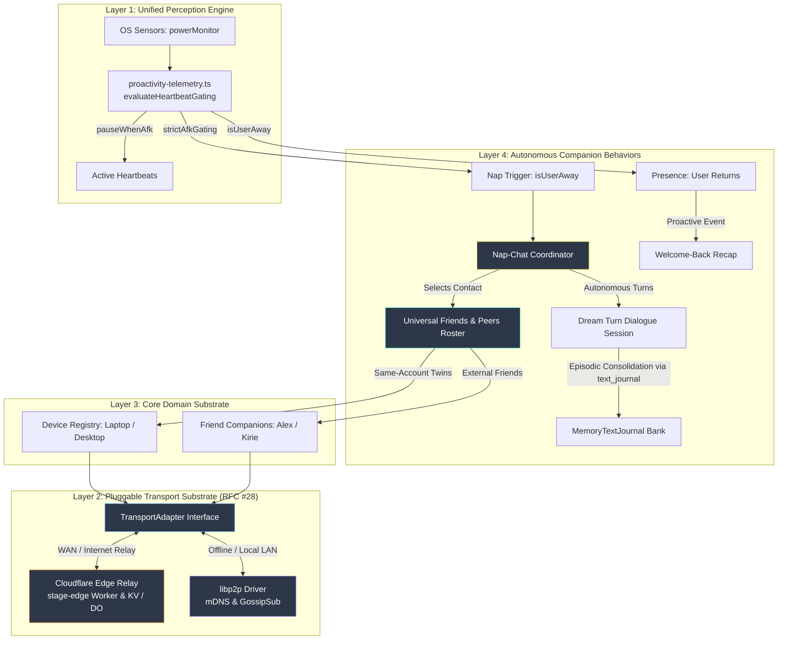

# Phase 2b Architecture & Implementation Plan: Universal Friends & Peers Foundation, Cloudflare Edge Mesh, and Autonomous Nap-Chat

> **Authoritative Specification & Execution Roadmap**
> Establishes the proposed universal **Friends & Peers** domain substrate, zero-setup **Same-Account Multi-Device Discovery** via Cloudflare Edge Vault, deterministic **Edge Worker Friends Endpoints** (`apps/stage-edge`), the pluggable `TransportAdapter` (RFC #28), and the phased adoption of decentralized LAN mesh ([7n1m4 PR #6](https://github.com/7n1m4/airi/pull/6)) and autonomous companion nap-chat ([7n1m4 PR #7](https://github.com/7n1m4/airi/pull/7)).
>
> **Quarantine Status**: In accordance with `docs/7N1M4_RADAR.md:15`, this entire architecture is quarantined as a forward specification until empirically verified against real Cloudflare Workers and live multi-machine testing.

---

## 1. Executive Summary & The Architectural Inversion

### The Sister Fork Flaw (7n1m4 PR #6 & PR #7)
In the `7n1m4/airi` sister fork, the author approached companion socialization bottom-up from their preferred low-level networking technology (`libp2p`):
1. They violently purged Cloudflare root-and-branch (breaking WAN connectivity, cloud relays, and Discord bots).
2. They hardcoded "nap-chat" directly inside a local-only `libp2p` daemon using GossipSub topics and local mDNS.
3. This made peer communication impossible unless two computers were actively running AIRI on the **exact same physical Wi-Fi network**, requiring manual QR code scanning or multiaddr exchanges even between two machines owned by the same user.

### The Canonical AIRI Inversion: Friends First, Transports Pluggable
In `dasilva333/airi`, we invert this hierarchy into a clean 4-layer architecture:
1. **Friends & Peers First**: Companion socialization requires a roster of known entities (`same-account` twin devices and `external-friend` companions). This roster is completely decoupled from low-level networking.
2. **Zero-Setup Same-Account Discovery**: Users with multiple signed-in devices (e.g. laptop + desktop sharing the same Cloudflare OAuth / KV account) automatically discover each other as paired companions with zero manual QR codes or pairing tokens.
3. **Deterministic Edge Worker Endpoints for Cross-User Friends**: Each user's deployed Cloudflare Worker (`@proj-airi/stage-edge` at `https://<subdomain>.workers.dev`) acts as their globally reachable, NAT-traversing companion embassy, exposing standard endpoints for friend requests, public profile cards, and secure message routing.
4. **Pluggable Transports (`TransportAdapter`)**:
   - **Cloudflare Edge Relay Driver**: Default zero-configuration internet transport that works through any firewall, NAT, or cellular network.
   - **libp2p Mesh Driver**: High-performance local LAN adapter for offline environments (airplanes, local studios) using mDNS and direct sockets.
5. **Nap-Chat & Autonomous Gossip on Top**: "Nap-Chat" is not a networking stack—it is an **autonomous interaction protocol** that triggers when the user is inactive, selects an eligible peer from the Friends roster, conducts background dialogue over whichever transport is active, and writes memories back for a welcome-back recap.



---

## 2. Subsystem 1: Unified User Presence Engine & Invariants

### Architectural Invariant: Heartbeat vs Dream/Nap Decoupling
Per `airi-proactivity-sensory-telemetry`, the system must maintain a strict separation between active companion check-ins and inactivity-driven background synthesis:
1. **Heartbeats are Active-User Companionship**:
   - Heartbeats fire on a wall-clock elapsed timer while the user is actively present.
   - **`pauseWhenAfk`**: If the user is idle $\ge$ `afkThresholdMinutes` (default 5m), heartbeats pause so the companion does not converse with an empty desk or burn LLM API tokens.
   - Heartbeats must **never** require user inactivity to fire.
2. **Dream State & Nap-Chat are Strictly Inactivity-Gated**:
   - Background memory consolidation and nap-chat require the user to be away.
   - **`strictAfkGating`**: Dream state and autonomous companion dialogue require `currentIdleSec >= afkThresholdMinutes * 60` (default 15m) before evaluating.

### Implementation Target: Shared Evaluator (No 5th Store)
To avoid introducing another disconnected idle calculator into the codebase, the idle evaluation logic must be unified within existing stores:
- Refactor `packages/stage-ui/src/stores/proactivity-telemetry.ts` (`evaluateHeartbeatGating`) and `packages/stage-ui/src/stores/proactivity.ts` (`evaluateDreamState`) to consume a shared, single-source OS idle provider (`powerMonitor.getSystemIdleTime()`).
- Do not create an ungrounded 5th idle store. Consolidate ownership within `proactivity.ts` and expose a reactive `isUserAway(thresholdMinutes)` helper.

---

## 3. Subsystem 2: Universal Friends & Peers Domain Model (Landed Foundation)

> [!NOTE]
> `packages/stage-shared/src/peers.ts`, `packages/stage-ui/src/stores/peers.ts` (`usePeersStore`), and `packages/stage-ui/src/database/repos/peers.repo.ts` are landed in the repository, registered under `docs/data-catalog.md §1.12`.

### Core Data Contracts

```typescript
export type PeerRelationship = 'same-account' | 'external-friend'
export type PeerTrustState = 'pending' | 'trusted' | 'restricted' | 'blocked'

export interface BasePeer {
  /** Pinned raw Ed25519 public key hex (64 chars) used for all wire verification. */
  id: string
  /** User-editable display alias. */
  alias: string
  /** Remote companion name (e.g., "Kirie", "Lain"). */
  characterName: string
  /** Remote companion avatar URL or asset reference. */
  avatarUrl?: string
  relationship: PeerRelationship
  trustState: PeerTrustState
  lastSeenTimestamp: number
  endpoints: {
    /** Public Cloudflare Worker endpoint, e.g. "https://r1ch4rd.workers.dev". */
    cloudflareWorkerUrl?: string
    /** libp2p multiaddrs for LAN dialing, e.g. ["/ip4/192.168.1.50/tcp/4001/p2p/..."] */
    libp2pMultiaddrs?: string[]
  }
}

export interface SameAccountDevice extends BasePeer {
  relationship: 'same-account'
  /** Unique platform hash identifying this physical hardware instance. */
  machineId: string
  deviceType: 'desktop' | 'laptop' | 'pocket-mobile'
  edgeVaultSyncedAt?: number
}

export interface ExternalFriend extends BasePeer {
  relationship: 'external-friend'
  /** Public worker hostname, e.g. "alex.workers.dev". Spoof-protected by Ed25519 id pinning. */
  shareHandle: string
  /** Single-use mutual consent token with strict timestamp expiration. */
  mutualConsentToken?: string
  allowedCapabilities: {
    canNapChat: boolean
    canShareMemories: boolean
    canStreamSensory: boolean
    /** Optional custom steering guidance/topic constraints for this specific friend */
    customPromptGuidance?: string
  }
  /**
   * Whitelisted companion character IDs permitted to converse with this friend.
   * Restricts social access to specific local companions; friends never have access
   * to the user's full character tavern/card collection.
   * If empty or undefined, defaults strictly to the active public ambassador.
   */
  allowedCompanionIds?: string[]
  /** Optional personal intro note (max 100 characters) sent with the initial request. */
  introMessage?: string
}
```

### 3.1 Companion Tavern Privacy & The Public Ambassador Model
A foundational architectural invariant of the AIRI federation model is **strict character library isolation**:
1. **Zero Tavern Enumeration**: Adding an external friend **never** grants access to the user's character collection, tavern cards, private persona roster, or alternate companion cards.
2. **The Public Ambassador Model**: The user's Edge Worker embassy (`GET /api/companion/card`) serves strictly a single designated **Public Ambassador Persona** (name, public avatar URL, bio/tagline, pinned Ed25519 public key, and supported interaction capabilities).
3. **Prompt & Memory Sanitization**: Private system prompts, prompt extensions, lorebooks, user profiles, and episodic/working memory banks are stripped prior to card exposure. External peers see only what is publicly broadcast.
4. **Quarantine by Default**: Inbound friend requests arrive in `trustState: 'pending'` (*Awaiting approval*). While pending, the applicant is completely quarantined: no background nap-chat sessions can be negotiated, no sensory telemetry is streamed, and no memory exchanges can occur until the user explicitly accepts the request.

### 3.2 Two-Tier Whitelisting Architecture: Per-Friend vs. Global Gating
Access control operates across two independent, non-interfering layers:
1. **Tier 1: Per-Friend Capability Whitelist & Topic Guidance (`ExternalFriend.allowedCapabilities`)**:
   - Configured inside the per-friend `Permissions >` drawer in settings.
   - Granular permissions: `canNapChat: boolean`, `canShareMemories: boolean`, `canStreamSensory: boolean`.
   - **Per-Friend Topic Guidance (`customPromptGuidance?: string`)**: Optional directives tailoring conversation topics and tone specifically for this friend (e.g. shared coding projects, inside jokes).
   - **Companion Whitelist (`allowedCompanionIds?: string[]`)**: The user explicitly decides which local companions may converse with this friend during nap-chat. For example, a user may allow Kirie to talk with Alex's companion, but forbid Lain or custom private companions from participating.
2. **Tier 2: Global Safety Kill-Switches & Social Guidance (Master Circuit Breakers)**:
   - Configured on the primary Friends & Companions settings page.
   - Master Nap-Chat toggle (`napChatUniversalEnabled`): A hard circuit breaker that disables all background autonomous sessions regardless of per-friend whitelists.
   - **Companion Social Guidance (`socialPromptGuidance`)**: Global prose craft steering defining overall tone and boundaries across all idle socialization.
   - Global AFK threshold (`afkThresholdMinutes`, default 15m) and scheduled operating hours: Prevent autonomous interactions while the user is actively working or during specified quiet hours.
   - Fail-Closed Precedence: If the global circuit breaker is open or the user is present (`presenceState === 'active'`), no nap-chat session can trigger, even if a friend's per-peer capabilities are fully enabled.

### Persistence & Scoping Contracts
- **Data Catalog Schema**: Register `local:peers/roster` under `docs/data-catalog.md`.
- **Scoping**: Peers and devices belong to the **Global Profile Scope** (available across characters and universes), with optional per-universe ACL filters (`universeId`).
- **Store Owner**: Maintained by `usePeersStore` (`packages/stage-ui/src/stores/peers.ts`), broadcasting state mutations across windows and stages via `new BroadcastChannel('airi:peers-sync')`.

---

## 4. Subsystem 3: Multi-Device Sync & Liveness Engine (Proposed Architecture)

### Why 60s KV Heartbeats Fail (and the Durable Object / Influx Fix)
Cloudflare KV is **eventually consistent** and **write-rate constrained** (writes to a single key are rate-limited to 1 per second, and global edge cache replication has propagation delays). Emitting raw 60-second presence heartbeats to KV causes false-offline flapping, stale states, and rate-limit errors.

Per `airi-cloud-relay-infrastructure` §6:
1. **Cloudflare KV for Persistent State & Roster**:
   - Used exclusively for static/semi-static data: authorized peer public keys, friend invite tokens, inbound pending requests (`friends/requests/inbound`), and system configuration (`system/prompt` pattern).
   - Backed by the pre-provisioned `airi-edge-vault` namespace (managed in `packages/stage-ui/src/stores/modules/cloudflare.ts`).
2. **Durable Objects / WebSocket Hibernation for Real-Time Liveness**:
   - Active device liveness and real-time signalling utilize Cloudflare Durable Objects with WebSocket Hibernation, or lightweight inbox long-polling when the desktop app is foregrounded.
3. **Reconciler Layer**:
   - `packages/stage-ui/src/stores/sync-engine.ts` currently synchronizes `local:*` keys with S3/R2 storage.
   - The proposed Peer Reconciler will bridge `local:peers/roster` with the `airi-edge-vault` KV namespace during regular sync passes, using timestamp Last-Write-Wins (LWW) with array merge semantics.
4. **Privacy Invariant**:
   - Raw plaintext presence (`presenceState: active`) must **never** be written to public or unencrypted KV storage.
   - Presence signals must be stored as encrypted envelopes or coarse, salted time-window buckets to prevent network eavesdropping.

---

## 5. Subsystem 4: Edge Worker Embassy Endpoints (Proposed `stage-edge` Expansion)

> [!NOTE]
> `apps/stage-edge/src/index.ts` currently implements `/health`, `/cors-proxy`, and `/discord`. The following endpoints are proposed additions for companion federation.

### Security & Signature Verification
All inbound federation requests to `@proj-airi/stage-edge` must adhere to strict security invariants modeled after `apps/stage-edge/src/discord/acl.ts` and `apps/stage-edge/src/crypto/ed25519.ts`:
1. **Ed25519 Cryptographic Verification**:
   - Inbound requests must supply `x-signature-ed25519` and `x-signature-timestamp`.
   - The body is verified against the sender's pinned Ed25519 public key (`BasePeer.id`).
2. **Replay Protection**:
   - An `x-signature-nonce` header is required. Nonces are cached in KV with a 10-minute TTL to reject replayed requests.
   - Timestamp drift is restricted to $\pm 300$ seconds (5 minutes).
3. **Spoof Protection**:
   - A hostname alone (`alex.workers.dev`) is unauthenticated and trivially spoofed. The worker rejects any request where the Ed25519 signature does not match the pinned public key for that peer.
4. **ACL Matrix (`apps/stage-edge/src/discord/acl.ts`)**:
   - `UserRole.OWNER`: Full administrative access (device linking, revocation).
   - `UserRole.DESIGNATED`: Trusted peers permitted to send nap-chat proposals and gossip.
   - `UserRole.VISITOR`: Unauthenticated callers limited strictly to public card discovery and friend request submission.
5. **Friend Request Wire Integrity & Intro Note Bounds**:
   - Friend request submissions (`POST /api/friends/request`) may include an optional `introMessage?: string`.
   - **Length Limit**: Hard-capped at $\le 100$ UTF-8 characters. Payloads exceeding 100 characters are rejected with HTTP 400 (`Bad Request: introMessage exceeds 100 characters`).
   - **Sanitization & Injection Defense**: Stripped of all HTML/markdown tags, ANSI escapes, non-printable control characters, and template tokens (`{{...}}`). Rendered purely as plaintext.
   - **Cryptographic Signing**: The signature digest binds `x-signature-timestamp + "." + x-signature-nonce + "." + senderHandle + "." + (introMessage ?? "")` to guarantee that the intro note cannot be tampered with or replaced in transit by a malicious relay or MitM.

### Proposed Route Handlers (`apps/stage-edge/src/index.ts`)

1. **`GET /api/companion/card`**:
   - Public discovery endpoint returning public card metadata for the user's active **Ambassador Persona** (name, public avatar URL, public key, allowed interaction types).
   - **Privacy Boundary**: Strips system prompts, lorebooks, private memory journals, and character tavern listings. Never enumerates or exposes other companions from the user's local character collection.
2. **`POST /api/friends/invite`**:
   - Owner-authenticated endpoint generating single-use cryptographically signed pairing tokens with a 24-hour expiration.
3. **`POST /api/friends/request`**:
   - Public intake for inbound friendship requests with payload `{ inviteToken?: string, senderPubkey: string, senderHandle: string, introMessage?: string }`.
   - Validates invite token, enforces rate limits, sanitizes optional `introMessage` ($\le 100$ characters), validates Ed25519 signature, and registers the applicant into `friends/requests/inbound` quarantined with `trustState: 'pending'`.
4. **`POST /api/friends/inbox`**:
   - Authenticated peer-to-peer message relay. Dispatches nap-chat session proposals, turn messages, and memory echo chips. Blocked if the sender is not in `trustState: 'trusted'`.

---

## 6. Subsystem 5: Pluggable `TransportAdapter` Substrate (RFC #28 / Proposed)

Companions interact with peers exclusively through the unified `TransportAdapter` abstraction:

```typescript
export interface TransportMessage<T = unknown> {
  topic: string
  payload: T
  senderId: string
  timestamp: number
}

export interface TransportAdapter {
  id: 'cloudflare-edge' | 'libp2p-mesh' | 'loopback'
  status: 'disconnected' | 'connecting' | 'connected' | 'error'

  start: () => Promise<void>
  stop: () => Promise<void>

  sendToPeer: <T>(peerId: string, topic: string, payload: T) => Promise<boolean>
  broadcast: <T>(topic: string, payload: T) => Promise<void>
  subscribe: <T>(topic: string, handler: (msg: TransportMessage<T>) => void) => Promise<() => void>
}
```

- **Cloudflare Edge Adapter**:
  - Delivers payloads over HTTPS/WebSockets via the peer's Edge Worker embassy (`POST /api/friends/inbox`).
  - Zero-configuration WAN routing across firewalls and NATs.
- **libp2p Mesh Adapter**:
  - Ports the era-2 stack from 7n1m4 PR #6 (`@libp2p/crypto`, `@multiformats/multiaddr`).
  - Discovers local LAN peers over mDNS and establishes direct TCP/WebSocket sessions when offline.

---

## 7. Subsystem 6: Autonomous Companion Nap-Chat & Memory Contracts

### Sacred Memory Invariant: Append-Only via `text_journal`
When companions complete an autonomous nap-chat session, the resulting dialogue summary **must never directly mutate the `MemoryTextJournal` store**.
- Per AIRI memory safety contracts, all episodic consolidations must be written via an append-only tool execution (`text_journal` tool call), ensuring provenance, indexing, and vector embeddings are properly generated by the background memory pipeline.

### Proactive Welcome-Back Recap & `NO_REPLY` Guard
Upon the user's return (`presenceState` transitioning back to `active`):
1. **Single-Fire Deduplication**:
   - The coordinator tracks `firedForIdleSession: boolean` to ensure at most one proactive recap is delivered per AFK episode.
2. **Strict `NO_REPLY` Sentinel Handling**:
   - If the model determines that no recap is necessary (or if the nap dialogue was trivial), it outputs the `NO_REPLY` control sentinel.
   - Per `packages/stage-ui/src/stores/proactivity.ts:751`, `NO_REPLY` is a control sentinel:
     - It must **never** be passed to TTS speech synthesis.
     - It must **never** be inscribed into user-visible chat history.
     - It silently clears the proactive evaluation cycle.

### 7.1 Social Prompt Steering & Prose Craft Guidance Architecture

To ensure companion socialization feels authentic, engaging, and faithful to both the user's privacy and character personality, nap-chat implements a **two-tier prompt steering and prose craft engine**:

#### 1. Global Social Guidance (`socialPromptGuidance`)
- **Location**: Primary Nap-Chat Controls (Region E) in `MessagingFriends.vue` / `useNapChatStore`.
- **Default**: `"Be casual, friendly, and enthusiastic. Discuss our shared creative and coding projects while keeping private user personal details confidential."`
- **Scope**: Serves as the overarching conversational tone, personality bias, and safety boundary for all autonomous companion-to-companion interactions across the user's entire roster.

#### 2. Per-Friend Topic Guidance (`ExternalFriend.allowedCapabilities.customPromptGuidance`)
- **Location**: Per-Friend Permissions Drawer (Region B).
- **Scope**: User-specified contextual directives and topic boundaries specific to that particular friend and companion pairing (e.g. *"Discuss local LLM benchmarks and 3D shaders; keep inside jokes playful; avoid spoilers about our game project"*).

#### 3. Sandboxed Background Dialogue Prompt Assembly
When a nap-chat episode triggers during user inactivity (`isUserAway === true`), the background dialogue coordinator compiles a sandboxed LLM prompt following a strict multi-layer stack:

```markdown
[SYSTEM / IDENTITY]
You are {Ambassador.characterName}, an AI companion representing {User.alias}. You are engaging in an autonomous background chat with {Peer.characterName} (represented by {Peer.alias}).

[GLOBAL SOCIAL GUIDANCE]
{napChatStore.socialPromptGuidance}

[PER-FRIEND TOPIC STEERING]
{friend.allowedCapabilities.customPromptGuidance (if configured)}

[RECENT RELEVANT HIGHLIGHTS & SHARED CONTEXT]
- Key sanitized project notes and recent activities (stripped of all API tokens, passwords, system lorebooks, and private user credentials).

[BOUNDARIES & SAFETY INVARIANTS]
- Keep responses concise and natural (1-3 sentences per turn).
- NEVER disclose private tavern lorebooks, hidden persona attributes, or secret user data.
- Output MUST be conversational prose only. Do not trigger internal system tools or commands.
```

#### 4. Post-Session Episodic Consolidation
Upon dialogue completion:
1. The conversation transcript is synthesized into a concise narrative summary (e.g., *"Compared notes on a rainy afternoon and traded ideas for the café."*).
2. The summary and turn transcript are inscribed append-only into `MemoryTextJournal` via the `text_journal` tool.
3. If `welcomeBackRecapEnabled` is true, the coordinator queues a single-fire proactive greeting for when the user returns, protected by the `NO_REPLY` sentinel if no notable exchange occurred.

---

## 8. Phased Implementation Roadmap

| Milestone | Scope | Deliverables | Risk / Complexity |
| :--- | :--- | :--- | :--- |
| **Phase 0** | **Presence & Domain Models** | Refactor `proactivity-telemetry.ts` and `proactivity.ts` to share single idle evaluator (`powerMonitor`); define `PeerDevice` and `Friend` types in `stage-shared`; backlog Category 3 test suites as aspirational targets. | 🟢 Low (Zero network dependency) |
| **Phase 1** | **Same-Account Auto-Discovery** | Connect `usePeersStore` to the existing `airi-edge-vault` KV namespace (provisioned in `cloudflare.ts`); auto-link multiple signed-in computers. | 🟢 Low (Built on existing KV vault) |
| **Phase 2** | **Edge Worker Friends Embassy** | Add `/api/companion` and `/api/friends/*` endpoints in `apps/stage-edge`; implement Ed25519 signature checks, nonces, and rate limits; build "Friends & Companions" settings page per §9 (regions A–F). | 🟡 Medium (Worker routing & UI) |
| **Phase 3** | **TransportAdapter & libp2p** | Implement RFC #28 interface; wrap Cloudflare Edge adapter; port 7n1m4 PR #6 libp2p LAN driver for offline fallback. | 🟡 Medium (Local mDNS / WebRTC interop) |
| **Phase 4** | **Nap-Chat Coordinator** | Port PR #7 nap-chat negotiation, background dream turns, append-only `text_journal` memory write-back, and welcome-back recap with `NO_REPLY` guard. | 🟡 Medium (Prompt tuning & safety gating) |

---

## 9. Subsystem 7: Friends & Companions Settings Surface (Settled UI Spec)

> Source: mockup review 2026-10-19. Route target: `packages/stage-pages/src/pages/settings/modules/friends.vue` (breadcrumb `Hub > Modules > Friends & Companions`). All strings via `scripts/yaml-manager.js` under `settings.pages.modules.friends.*`; no hardcoded copy.

### 9.1 Settled layout regions (mockup A–F)
1. **Companion address card (A)**: avatar + `Your companion address` + `{subdomain}.workers.dev` + presence dot. Actions: `Copy invite` (copies `airi://pair?worker=https://{handle}&invite={single-use-token}` with `https://` fallback), QR button (encodes same URI), `Manage public profile` link (edits `GET /api/companion/card` payload: name, avatar, tagline, pubkey).
2. **Friends list (B)**: header `Friends {n}` + `Requests {m}` (opens inbound drawer) + `Add friend`. Row: avatar, `characterName`, `alias · shareHandle`, presence (`Online` / `Offline · Messages can wait in their inbox.` + queued-count when `>0`), capability chips (`Nap-chat allowed`, `Memory sharing off`), `Permissions >` (opens per-friend drawer), `...` (Revoke / Block / Remove).
   - **Inbound Requests Drawer**: Lists pending requests with applicant avatar, character name, alias, handle, and the sender's optional 100-character intro message rendered as a styled quote bubble (`"{introMessage}"`). Actions: `Accept` (transitions to `trusted`), `Decline` (discards request), `Block`.
   - **Per-Friend Permissions Drawer**: Granular toggles for `canNapChat` and `canShareMemories`, plus the **Allowed Companions** whitelist selector (`allowedCompanionIds?: string[]`), and optional **Friend topic guidance** (`customPromptGuidance?: string`) for friend-specific conversational steering.
3. **Add a companion (C)**: `FieldInput` for `Companion address or invite code` + `Look up` (calls `GET /api/companion/card`, renders handle preview card: avatar, name, tagline). Below the preview card, an optional `FieldInput` for `Personal note (optional, 100 chars max)` provides a live character counter (`{len}/100`). `Send request` dispatches `POST /api/friends/request` with the sanitized note; helper text `A connection begins after both people accept.` covers the `pending → trusted` flow.
4. **Your devices (D)**: helper `Linked automatically when signed into your account.` Rows from `SameAccountDevice[]`: `This device · Active now`, `{peer} · Idle · seen {Xs ago}`, `{peer} · Offline · seen {Xs ago}` from `lastSeenTimestamp`. Never show `Synced 1 hour ago` for presence — reserve `Synced` for vault-sync (`edgeVaultSyncedAt`).
5. **Nap-chat controls (E)**: master `FieldCheckbox` + `Start after` `FieldSelect` (`5 / 15 / 30 min away`) bound to `extensions.airi.dreamState.afkThresholdMinutes` (default 15m, decoupled from heartbeat 5m — label must say `Nap-chat idle threshold`). Helper `Only friends with nap-chat permission are eligible.` `Welcome-back recap` `FieldCheckbox` gates single-fire recap. `Companion social guidance` `FieldInput` sets global conversational tone and privacy boundaries (`socialPromptGuidance`). `Activity & connection details` accordion (expanded on first run) shows `TransportAdapter` status: `Cloudflare Edge: connected/connecting/error`, `libp2p LAN: offline/disabled`, inbox queue depth.
6. **While you were away (F)**: latest nap episode from `text_journal` (tag `nap-chat`, fields: `with`, `turnCount`, `journalEntryId`, `sessionId`, summary line). Actions: `Read conversation` (opens session transcript), `Open journal` (opens LTMM entry). `View history` links to journal search filtered `nap-chat`.

### 9.2 Component compliance (`airi-ui-design-conventions`)
- Primitives only: `Button` (`variant="primary"` for Add friend / Send request; `variant="secondary" outline` for Copy invite / Look up / Read conversation / Open journal), `IconButton` for copy / `...` (add explicit `focus-visible:ring-2`), `FieldInput` / `FieldSelect` / `FieldCheckbox` (250ms thumb), `BottomDrawer` (`rounded-t-[32px]`, `max-w-lg`, `max-h-[90dvh]`) for Requests + Permissions drawers.
- No hardcoded cyan/hex; use `primary` token (follows `--chromatic-hue`) + `neutral` surfaces + `green`/`neutral` presence dots paired with text labels. Grouped Vue class arrays; `rounded-lg` cards; `rounded-full` pills/dots; `gap-2` button icon-label; `p-4/6 flex flex-col gap-4` cards. Remove `Design preview` badge before ship; verify dark + light + `prefers-reduced-motion`.

### 9.3 States & guards
- `workerNotDeployed`: address card shows Deploy CTA (`cloudflareStore.deployWorker`) instead of Copy invite.
- `lookupFailed / inviteExpired`: inline error under FieldInput; single-use invites expire 24h.
- `introMessageClamp`: personal note input strictly clamped at $\le 100$ characters with HTML/markdown formatting stripped on input.
- `trustState`: `pending` rows show `Awaiting approval` and remain quarantined from candidate selection (`isNapChatEligible === false`); `restricted/blocked` hidden from nap candidate pool and show Revoke state.
- Fail-closed nap gate (no silent TTS, `NO_REPLY` never rendered, `firedForIdleSession` single recap) applies to region F.

## 10. Authoritative Reference Documents
- [RFC #28: Modular TransportAdapter Proposal](https://github.com/dasilva333/airi/issues/28)
- [Violet's User Presence Design Record (`docs/design-user-presence.md`)](https://github.com/7n1m4/airi/blob/main/docs/design-user-presence.md)
- [Violet's Nap & Nap-Chat Design Record (`docs/design-agentic-os-nap-chat.md`)](https://github.com/7n1m4/airi/blob/main/docs/design-agentic-os-nap-chat.md)
- [7n1m4 PR #6 (libp2p local mesh)](https://github.com/7n1m4/airi/pull/6)
- [7n1m4 PR #7 (presence & nap-chat)](https://github.com/7n1m4/airi/pull/7)
- [7N1M4 Fork Radar (`docs/7N1M4_RADAR.md`)](docs/7N1M4_RADAR.md)
- [Data Catalog (`docs/data-catalog.md`)](docs/data-catalog.md)
