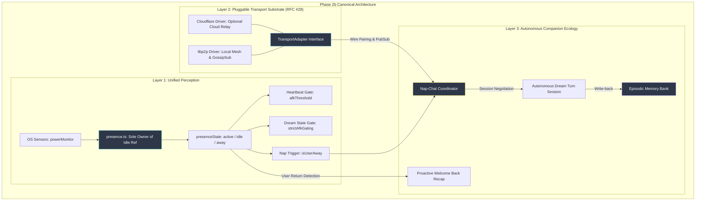

# Phase 2b Architecture & Implementation Plan: Modular Mesh Transport & Companion Nap-Chat

> **Authoritative Specification & Execution Roadmap**
> Tracks the staged adoption of the decentralized `libp2p` local mesh foundation ([7n1m4 PR #6](https://github.com/7n1m4/airi/pull/6)) and autonomous companion nap-chat ([7n1m4 PR #7](https://github.com/7n1m4/airi/pull/7)), built upon the unified presence engine and the pluggable [`TransportAdapter`](https://github.com/dasilva333/airi/issues/28) substrate.

---

## 1. Executive Summary & Architectural Goals

The goal of Phase 2b is to adopt the high-velocity innovations developed in the `7n1m4/airi` sister fork without compromising `dasilva333/airi`'s core principles:
1. **Zero Hard Forks**: Instead of violently purging Cloudflare root-and-branch (which broke cloud relays and Discord integration), abstract the transport layer into a pluggable `TransportAdapter`.
2. **First-Class Sovereign Mesh**: Equip companions on the same LAN with cryptographic node identities, mDNS local discovery, and over-the-wire GossipSub pairing.
3. **Canonical Presence Substrate**: Resolve the legacy 4-way duplicate user-idle logic into a single authoritative engine (`presence.ts`).
4. **Autonomous Companion Nap-Chat**: Enable companions to autonomously converse over the mesh while users are inactive (napping), log experiences into episodic memory, and summarize their interactions when the user returns.



---

## 2. Subsystem 1: Unified User Presence Engine (Phase 0)

### The Legacy Problem (Upstream AIRI)
User inactivity was previously computed and evaluated four uncoordinated ways:
1. `apps/stage-tamagotchi/src/main/services/sensors/index.ts`: Pushes raw OS idle seconds from `powerMonitor.getSystemIdleTime()`.
2. `packages/stage-ui/src/stores/proactivity.ts`: Maintained a raw `idleTimeSec` ref updated on a 10s loop.
3. `packages/stage-ui/src/stores/presence.ts`: Computed `active`/`idle`/`away`, but no subsystem consumed it.
4. `packages/stage-ui/src/stores/proactivity.ts` (`evaluateDreamState`): Evaluated its own inline `(config.afkThresholdMinutes || 5) * 60`, completely bypassing `presence.ts`.

### The Canonical Model (`docs/design-user-presence.md`)
* [`packages/stage-ui/src/stores/presence.ts`](file:///Users/richardpinedo/Projects.nosync/airi/airi_dasilva333/packages/stage-ui/vitest.config.ts) becomes the **single authoritative owner** of the raw idle signal.
* Pluggable `PresenceSignalProvider` interface supports OS idle time, lock/sleep events, and native window focus.
* **Per-Feature Threshold Decoupling**:
  * `heartbeat` keeps its own `afkThresholdMinutes` (default 5m).
  * `dreamState` keeps its own `afkThresholdMinutes` (required, default 15m).
  * Both read from the single derived presence engine (`isUserAway(thresholdMinutes)`).
* **Unblocks**: 15 Category 3 parked test suites (`presence-signal.test.ts`, `dream-state-gate.test.ts`).

---

## 3. Subsystem 2: Pluggable `TransportAdapter` Layer (RFC #28)

To support both sovereign local mesh networking and zero-configuration cloud relays, all transport operations are mediated by a unified interface:

```typescript
export interface TransportMessage<T = unknown> {
  topic: string
  payload: T
  senderPeerId: string
  timestamp: number
}

export interface TransportAdapter {
  id: 'libp2p' | 'cloudflare' | 'local-loopback'
  status: 'disconnected' | 'connecting' | 'connected' | 'error'

  start: () => Promise<void>
  stop: () => Promise<void>

  publish: <T>(topic: string, payload: T) => Promise<void>
  subscribe: <T>(topic: string, handler: (msg: TransportMessage<T>) => void) => Promise<() => void>

  getPeers: () => Promise<Array<{ peerId: string, addresses: string[], latencyMs?: number }>>
}
```

* **`libp2p` Transport Driver**:
  * Operates on LAN using mDNS discovery, TCP/WebSockets, AutoNAT, and GossipSub.
  * Dependency graph pinned to era-2 (`@libp2p/crypto 5.1.8`, `@multiformats/multiaddr`).
  * Dynamic import of `@libp2p/webrtc` to prevent Electron startup segfaults.
* **`cloudflare` Transport Driver**:
  * Preserved for users requiring zero-maintenance cross-network companion syncing, WebRTC signaling, and Discord bot integration.

---

## 4. Subsystem 3: Over-the-Wire Pairing Protocol (PR #6)

Legacy pairing used a module-local in-memory `Map`, meaning only the single process that created the invite could redeem it. PR #6 established true cross-process and cross-device pairing:

1. **GossipSub Topics**:
   * `airi/pairing/invites`: Published by the inviting companion with public identity metadata and TTL.
   * `airi/pairing/requests`: Published by the accepting peer companion containing peer address and handshake request.
2. **Strict Wire Security Invariant**:
   * The broadcast invitation payload is strictly typed:
     ```typescript
     export type PairingWireInvitation = Omit<PairingInvitation, 'token'>
     ```
   * The secret single-use pairing token is **never serialized onto GossipSub**. It is verified directly by the issuing inviter node.
3. **Peer Management UI**:
   * Integrated into `packages/stage-pages/src/pages/settings/modules/libp2p.vue`.
   * QR Code scanner/generator component moved to `@proj-airi/ui/components/misc/qrcode.vue`.
   * Custom paired-device aliases and revocation controls.

---

## 5. Subsystem 4: Autonomous Companion Nap-Chat (PR #7)

### The Inactive Companion Premise
When a user steps away from their desk, companions should not remain frozen in passive idle loops. Instead, they enter a "napping" state and can engage in autonomous peer dialogue.

### Execution Cycle:
1. **Inactivity Detection**:
   `presence.ts` signals `isUserAway(afkThreshold) === true`. The companion enters `napState = 'napping'`.
2. **Peer Discovery & Invitation**:
   A paired companion on the mesh detects the nap state and broadcasts a chat proposal over GossipSub.
3. **Session Negotiation & Model Gating**:
   * Mutual consent verification: only paired and trusted companions can initiate a nap-chat session.
   * Fail-closed model gate: ensures an LLM inference provider is active and capable of background turns without blocking the primary user conversation.
4. **Autonomous Conversation Turns**:
   * The companions exchange structured dialogue in background dream context (typically 3–6 turns).
   * Generates no audible TTS or intrusive screen animations while the user is away.
5. **Memory Bank Write-Back**:
   * The completed dialogue is passed to the Episodic Memory Bank (`MemoryTextJournal`) and distilled into long-term knowledge.
6. **Presence Restoration & Welcome-Back Recap**:
   * When `presence.ts` detects the user has returned (`active`), the companion surfaces a single proactive message:
     *"While you were away, I had a brief chat with Kirie about our project notes!"*

---

## 6. Phased Implementation Roadmap

| Milestone | Scope | Deliverables | Risk / Complexity |
| :--- | :--- | :--- | :--- |
| **Phase 0** | **Presence Substrate** | Refactor `presence.ts` as sole idle owner; clean up `proactivity.ts` 4-way duplicate; unblock 15 Category 3 tests. | 🟢 Low (Zero network dependencies) |
| **Phase 1** | **Transport Interface** | Create `TransportAdapter` contract; wrap Cloudflare relay as default adapter. | 🟢 Low (Pure interface refactor) |
| **Phase 2** | **libp2p Mesh Driver** | Port PR #6 era-2 libp2p stack, GossipSub wire pairing, and QR component; add settings tab. | 🟡 Medium (Node/Electron WebRTC interop) |
| **Phase 3** | **Nap-Chat Coordinator** | Port PR #7 nap-chat negotiation, background dream turns, memory write-back, and welcome-back recap. | 🟡 Medium (Prompt & memory tuning) |

---

## 7. Authoritative Reference Documents
* [RFC #28: Modular TransportAdapter Proposal](https://github.com/dasilva333/airi/issues/28)
* [Violet's User Presence Design Record (`docs/design-user-presence.md`)](https://github.com/7n1m4/airi/blob/main/docs/design-user-presence.md)
* [Violet's Nap & Nap-Chat Design Record (`docs/design-agentic-os-nap-chat.md`)](https://github.com/7n1m4/airi/blob/main/docs/design-agentic-os-nap-chat.md)
* [7n1m4 PR #6 (libp2p local mesh)](https://github.com/7n1m4/airi/pull/6)
* [7n1m4 PR #7 (presence & nap-chat)](https://github.com/7n1m4/airi/pull/7)
