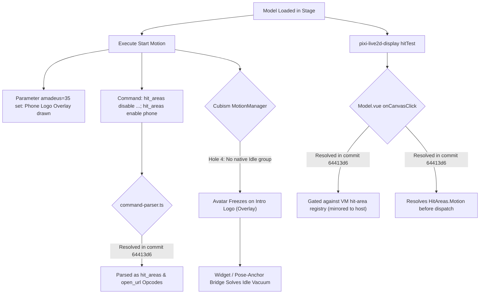

# Project Amadeus: Bespoke Live2D Generative UI Widget Bridge & Tactile Introspection Substrate
### 📱 Unlocking Creator-Scripted Live2D Models via Sandboxed Micro-Apps & Engine HitArea Introspection
**Specification & Architectural Design**

> **Status**: Approved Architecture — Phase 1 & 2 Engine Fixes Complete (Commits `64413d6a2b`, `6870c79e95`); Phase 3 Bridge & Widget in Progress
> **Authors**: Richard Pinedo (@dasilva333 / azimuthal) & Antigravity Pair
> **Date**: 2026-10-15
> **Related Documents**:
> - [`docs/design-live2d-gimmick-deck-introspection.md`](./design-live2d-gimmick-deck-introspection.md) — Live2D tactile raycasts, Gimmick Deck, and DSL state machine introspection.
> - [`docs/design-generative-widgets-export-and-scoping.md`](./design-generative-widgets-export-and-scoping.md) — Export interface, scoping architecture (`global` vs `card`), and bundled starter presets.
> - [`docs/proposal-in-memory-sandboxes-and-edge-wasm.md`](./proposal-in-memory-sandboxes-and-edge-wasm.md) — Master proposal for sandboxed generative micro-frontends.
> - [`docs/research-live2d-special-sauce.md`](./research-live2d-special-sauce.md) — Empirical audit of creator-scripted Live2D packages.
> - [`docs/design-live2d-dsl-interpreter-spec.md`](./design-live2d-dsl-interpreter-spec.md) — Live2D DSL interpreter grammar, command pipeline, and reactive store.

---

## 1. Executive Summary & Proving Ground

Community Live2D creator packages (Wallpaper Engine, Bilibili, and game rips) frequently implement rich, self-contained interactive experiences. A prime benchmark is **Steam Workshop ID `2022880016`** (*命运石之门 - 牧濑红莉栖 / Steins;Gate Makise Kurisu*, authored by Bilibili creator `呦克里斯汀娜呦` based on the fan-favorite *Project Amadeus* mobile application).

While standard Cubism 3 models only contain passive mesh animations and an `"Idle"` motion pool, this model contains:
- **37 Interactive Tactile Hit Areas** simulating a smartphone operating system on the avatar's textures.
- **A 12-Track Steins;Gate BGM Jukebox** (~54 MB of MP3 audio tracks).
- **16 Voiced Interactive Dialogue Reactions** across 5 categories with probabilistic weights.
- **Custom Semicolon Command Pipelines** (`hit_areas enable/disable`, `stop_sound 0`, and `open_url`).

### The Two-Pillar Solution Architecture

To unlock this model—and any future creator-scripted Live2D package—we partition the solution into two distinct layers:

```
┌────────────────────────────────────────────────────────────────────────────────────────┐
│                              AMADEUS ARCHITECTURAL STACK                               │
├────────────────────────────────────────────────────────────────────────────────────────┤
│                                                                                        │
│   PILLAR 1: CORE ENGINE & RUNTIME FIXES (SHIPPED & TESTED)                             │
│   • live2d-runtime: hit_areas & open_url opcodes parsed (commit 64413d6)               │
│   • stage-ui-live2d: Model.vue gating + collider Name ➔ Motion resolution              │
│   • stage-ui-live2d: introspector parses HitAreas + sound-only reactions (commit 6870c79│
│   • Live2dGimmickDeck: Tactile Zones UI + Translate-All discovery                      │
│                                                                                        │
│                                           │                                            │
│                                           ▼                                            │
│   PILLAR 2: VIRTUAL WORKSTATION BRIDGE & GENERATIVE UI WIDGET                          │
│   • Zero LLM Tool Calls: Pure POSIX shell & runtime bindings                           │
│   • In-Memory Projections: /workspace/.airi/live2d.json state mirror                   │
│   • Sandbox Node Runtime: require('live2d') shim next to fs, path, mcp, jev            │
│   • Virtual Bash Command: live2d dispatch, live2d hits, live2d state                   │
│   • Two-Tier Distribution Split:                                                       │
│     - Bundled in Core: Model-agnostic Universal Live2D Menu Engine                     │
│     - Side-loaded in User Card: Amadeus OS Glassmorphic Theme & Kurisu preset           │
│                                                                                        │
└────────────────────────────────────────────────────────────────────────────────────────┘
```

---

## 2. Root Cause Audit & Verified Engine Status

Auditing [`2022880016.model3.json`](file:///Users/richardpinedo/Projects.nosync/airi/personal_airi/the-clockwork-roast-haven-cafe_card/models/steins_gate__makise_kurisu_/2022880016.model3.json) against AIRI's codebase revealed five critical engine holes:



### Verified Engine Status Matrix

| # | Engine Hole | Prior Behavior | Current Status | Commit |
|---|---|---|---|---|
| **1** | Parser Opcode Hole (`command-parser.ts`) | `hit_areas` and `open_url` fell into `default: noop` | **RESOLVED**: Parsed into typed opcodes with comma/`、` splitting and URL validation | `64413d6a2b` |
| **2** | Collider Mapping Hole (`Model.vue`) | Dispatched `hitArea.Name` (`表白1`), ignoring `hitArea.Motion` (`互动（表白1）`) | **RESOLVED**: Resolves `declaration?.Motion \|\| hitArea` before calling `dslVM.dispatch` | `64413d6a2b` |
| **3** | Initial Collider State Hole (`Model.vue`) | Ignored `Enabled: false`, keeping all 37 colliders active at once | **RESOLVED**: VM hit-area registry (`Map`) seeded from manifest `Enabled` flags, mirrored to the host adapter, updated via DSL dispatches | `64413d6a2b` |
| **4** | Idle Pool Vacuum (`model3.json`) | No `"Idle"` motion pool; parameter `amadeus = 35` left model frozen | **ARCHITECTURAL**: Model lacks `Idle` group. Bridged via pinned motion / widget pose lock | *Card/Widget* |
| **5** | Introspector Blindspot (`introspector.ts`) | Required `entry.Text`, dropping raw sound clips and ignoring `HitAreas` | **RESOLVED**: Captures `hitAreas[]` and surfaces sound-only reactions with fallback labels | `6870c79e95` |

---

## 3. The Live2D ↔ Virtual Workstation Bridge Specification

A crucial architectural principle: **Do not introduce LLM tool calls for widget-to-model interaction.**

Interactive UI controls (such as pressing "Play Track" on a music player or dialing a phone number) must have frame-perfect, sub-millisecond tactile response. Round-tripping user interface clicks through an LLM introduces 1.5–3 seconds of latency, burns API tokens, and risks hallucinated parameters.

Instead, the bridge uses the **Sandbox POSIX Virtual Workstation** ([`airi-sandbox-virtual-workstation`](file:///Users/richardpinedo/Projects.nosync/airi/.agents/skills/airi-sandbox-virtual-workstation/SKILL.md)) and its ambient runtime shims.

### 3.1 Ambient State Projection (`/workspace/.airi/live2d.json`)

The sandbox manager automatically extends its one-way ambient mirror (`projections.ts`) to export the active Live2D model state:

```json
{
  "modelId": "steins_gate__makise_kurisu_",
  "activeMotion": "互动（闲聊1）",
  "activeCostume": null,
  "enabledHitAreas": [
    "phone"
  ],
  "varFloats": {
    "music_playing": 0,
    "intimacy": 15
  },
  "capabilities": {
    "hasDsl": true,
    "hitAreasCount": 37,
    "reactionsCount": 30,
    "costumesCount": 0
  },
  "updatedAt": 1729015800000
}
```

Scripts and terminal users can inspect this ambient state without any RPC:
```bash
cat /workspace/.airi/live2d.json | jq .enabledHitAreas
```

### 3.2 Virtual `require('live2d')` in In-Memory Node Runtime

In `packages/stage-ui/src/libs/sandbox/manager.ts`, `customRequire` is extended alongside `fs`, `path`, `mcp`, and `jev`:

```ts
// packages/stage-ui/src/libs/sandbox/shims/live2d.ts
export interface VirtualLive2dBridge {
  /** Dispatches a motion group, hit area name, or DSL command */
  dispatch: (target: string) => Promise<boolean>
  /** Checks if a specific tactile hit area is currently enabled in the state machine */
  isHitAreaEnabled: (name: string) => boolean
  /** Returns the full snapshot of active Live2D DSL state */
  getDslState: () => Live2dDslState | null
  /** Updates a numeric variable in the Live2D VarFloats reactive heap */
  setVar: (name: string, value: number) => void
  /** Returns introspected capabilities of the active model */
  getCapabilities: () => Live2dCapabilities | null
}
```

Scripts running inside the virtual workstation (or background tasks) can execute:
```js
const live2d = require('live2d')

// Trigger greetings topic
live2d.dispatch('互动（打招呼1）')

// Query active hit areas
if (live2d.isHitAreaEnabled('phone')) {
  console.log('Amadeus phone receiver is open!')
}
```

### 3.3 Virtual Bash CLI (`live2d`)

A virtual CLI tool is registered in `just-bash` command dispatcher:
- `live2d dispatch <group>` — Triggers motion or DSL command.
- `live2d hits [--enabled-only]` — Lists discovered hit areas and current gate states.
- `live2d state` — Emits active state JSON.

```bash
# Dial into Amadeus from bash
live2d dispatch "phone"

# Check active gates
live2d hits --enabled-only
```

### 3.4 Widget ↔ Live2D Direct Communication Contract

For Generative UI widgets hosted inside sandboxed iframes ([`AiriWidgetContext`](file:///Users/richardpinedo/Projects.nosync/airi/.agents/skills/airi-generative-widgets/SKILL.md)), two interaction flavors are supported:

#### Flavor A: State-File Sync Loop (Autonomous / Zero Host Diff)
- The widget calls `setState({ requestMotion: '音乐（amadeus）' })`.
- A background node script (`node watcher.js &`) in `/workspace` observes `/workspace/<name>.json` and invokes `live2d.dispatch()`.
- *Pros*: Zero changes required to the widget host surface; completely open to agent script orchestration.
- *Cons*: Subject to debounce latency (~50-100ms) and terminates if the window reloads.

#### Flavor B: Allowlisted Host Message Port (Frame-Perfect Tactile Response — Recommended)
- Inside [`srcdoc.ts`](file:///Users/richardpinedo/Projects.nosync/airi/packages/stage-ui/src/libs/sandbox/srcdoc.ts), the injected widget bridge exposes:
  ```ts
  window.parent.postMessage({
    type: 'airi:live2d:dispatch',
    target: '互动（表白1）',
  }, '*')
  ```
- The host surfaces ([`ChatWorkspaceWidgetsPanel.vue`](file:///Users/richardpinedo/Projects.nosync/airi/packages/stage-ui/src/components/scenarios/chat/ChatWorkspaceWidgetsPanel.vue), [`FloatingWidgetCard.vue`](file:///Users/richardpinedo/Projects.nosync/airi/packages/stage-ui/src/components/scenarios/widgets/FloatingWidgetCard.vue), [`Generative.vue`](file:///Users/richardpinedo/Projects.nosync/airi/apps/stage-tamagotchi/src/renderer/widgets/generative/components/Generative.vue)) forward allowlisted `airi:live2d:*` actions directly to the active Live2D store / `Model.vue` instance.
- *Pros*: Zero latency, frame-accurate synchronization with audio playback.
- *Host-side trust requirements (blocking for Phase 3)*: the widget posts with targetOrigin `'*'`, so each host handler MUST validate `event.source` against the mounted widget iframe and drop any message whose `type` does not carry the `airi:live2d:` prefix. Cover with a unit test asserting a non-allowlisted message is ignored.

---

## 4. Distribution Architecture: Bundled Universal Engine vs Side-Loaded Model Skin

### 4.1 The Intellectual Property & Maintenance Boundary

| Layer | Content | Legal / IP Status | Distribution Strategy |
|---|---|---|---|
| **Live2D Binary Assets** | `.moc3`, texture `.png`, audio `.wav`/`.mp3` | **High IP Risk**: Proprietary to MAGES./5pb./Chiyomaru Studio. | **Never in repo**. Lives strictly in user's `personal_airi/` or external model library. |
| **Model Metadata & Song Titles** | Track names, Kurisu character strings | Trademark-nominative; deadweight if hardcoded for a single model. | **Card-Scoped**. Lives inside character card directory. |
| **Generic Menu Engine** | Model-agnostic UI renderer for `hitAreas` and `reactions` | **Zero IP Risk**. Generic utility code. | **Bundled in core AIRI** (`@proj-airi/stage-ui`). |
| **Amadeus OS Skin** | Sci-Fi Green CRT theme, glassmorphic HUD styling | **Zero IP Risk**. CSS/UnoCSS styling and layout. | **Side-Loaded Companion Widget** attached to character card. |

### 4.2 The Architectural Split

```
airi/ (Public Repository)
└── packages/stage-ui/src/components/scenarios/widgets/presets/
    └── Live2dMenuDriver.ts           <-- Universal, model-agnostic controller
        (Renders any model's hitAreas, reactions, and audio tracks dynamically)

personal_airi/the-clockwork-roast-haven-cafe_card/ (User Space)
├── card.json
├── manifest.json                     <-- Declares extensions.airi.widgets
└── widgets/
    └── amadeus_theme.ts              <-- Specialized Amadeus CRT skin & Kurisu overrides
```

### 4.3 Universal Live2D Menu Engine (`Live2dMenuDriver.ts`)

The universal driver reads `capabilities` directly from the Live2D store or `/workspace/.airi/live2d.json`:
1. It automatically groups `reactions` into dialogue categories.
2. It detects sound tracks (`.mp3` / `.wav` in reactions) and renders a generic Jukebox.
3. It displays tactile hit-area gates and allows toggling them.
4. It accepts an optional **Skin Configuration Object**:
   ```ts
   export interface Live2dWidgetSkin {
     title: string
     subtitle?: string
     accentColor: 'emerald' | 'cyan' | 'amber' | 'rose' | 'violet'
     customTrackTitles?: Record<string, string>
     customGroupLabels?: Record<string, string>
     poseAnchorMotion?: string
   }
   ```

### 4.4 Amadeus Skin Configuration (`amadeus_theme.ts`)

When Kurisu's card is loaded, the Amadeus skin supplies the thematic overrides:
```ts
export const amadeusSkin: Live2dWidgetSkin = {
  title: 'AMADEUS SYSTEM v3.04',
  subtitle: '1.048596% Divergence',
  accentColor: 'emerald',
  poseAnchorMotion: '互动（闲聊1）',
  customTrackTitles: {
    '音乐（amadeus）': 'Amadeus (S;G 0 OP)',
    '音乐（hacking）': 'Hacking to the Gate',
    '音乐（gate）': 'Gate of Steiner',
    '音乐（观测者）': 'Skyclad Observer',
    '音乐（another）': 'Fatima (Another)',
    '音乐（星之歌）': 'Song of Stars',
  },
  customGroupLabels: {
    '互动（打招呼1）': '👋 Greetings',
    '互动（闲聊1）': '☕ Lab Chitchat',
    '互动（kurisu1）': '🔬 Kurisu Persona',
    '互动（调戏2）': '😳 Teasing',
    '互动（表白1）': '💌 Confession',
  },
}
```

---

## 5. Implementation Plan & Delivery Phases

```
┌────────────────────────────────────────────────────────────────────────────────────────┐
│                              PHASED EXECUTION ROADMAP                                  │
├────────────────────────────────────────────────────────────────────────────────────────┤
│                                                                                        │
│   PHASE 1: CORE PARSER & DISPATCHER (DONE - Commit 64413d6)                            │
│   [x] Add hit_areas and open_url opcodes to command-parser.ts                          │
│   [x] Wire enabledHitAreas reactive set & target Motion resolution in Model.vue        │
│   [x] Unit tests in command-parser.test.ts and interpreter.test.ts                     │
│                                                                                        │
│   PHASE 2: INTROSPECTION & GIMMICK DECK (DONE - Commit 6870c79)                        │
│   [x] Parse HitAreas in introspector.ts with enabled/disabled status                   │
│   [x] Allow sound-only entries as reactions using groupName fallback                   │
│   [x] Add Tactile Zones UI & Translate-All queue in Live2dGimmickDeck.vue              │
│   [x] Unit tests in stage-ui/src/features/motions/live2d/introspector.test.ts          │
│                                                                                        │
│   PHASE 3: SANDBOX WORKSTATION BRIDGE & PROJECTIONS                                    │
│   [ ] Add /workspace/.airi/live2d.json ambient state projection in projections.ts      │
│   [ ] Implement virtual require('live2d') shim in stage-ui/src/libs/sandbox/           │
│   [ ] Add virtual live2d CLI command to SandboxManager                                 │
│   [ ] Wire direct allowlisted postMessage ('airi:live2d:dispatch') in widget hosts     │
│                                                                                        │
│   PHASE 4: UNIVERSAL MENU ENGINE & AMADEUS SKIN                                        │
│   [ ] Author Universal Live2D Menu Engine widget (Live2dMenuDriver.ts)                 │
│   [ ] Author Card-Scoped Amadeus CRT Skin in Haven Cafe card folder                    │
│   [ ] Test jukebox playback, pose-anchoring (solving Hole 4), and topic triggering     │
│                                                                                        │
└────────────────────────────────────────────────────────────────────────────────────────┘
```

---

## 6. Verification Matrix

| Check | Target | Verification Method |
|---|---|---|
| Ambient Projection | `/workspace/.airi/live2d.json` | Start Live2D model, run `cat /workspace/.airi/live2d.json` in virtual bash; verify `enabledHitAreas` matches model state. |
| Node Require Shim | `require('live2d')` in sandbox | Run `node -e "const l = require('live2d'); console.log(l.isHitAreaEnabled('phone'))"` in sandbox; verify boolean output. |
| Virtual CLI | `live2d dispatch` | Run `live2d dispatch "phone"` in sandbox terminal; verify stage avatar transitions without errors. |
| Widget Dispatch | `context.live2d.dispatch()` | Mount widget, click Jukebox track; verify audio plays and active stance holds. Unit test: non-allowlisted postMessage is dropped. |
| Workspace Safety | Typechecks & Tests | `pnpm -F @proj-airi/stage-ui typecheck`, `pnpm -F @proj-airi/stage-ui-live2d typecheck`, `pnpm -F @proj-airi/stage-ui test run`. |
