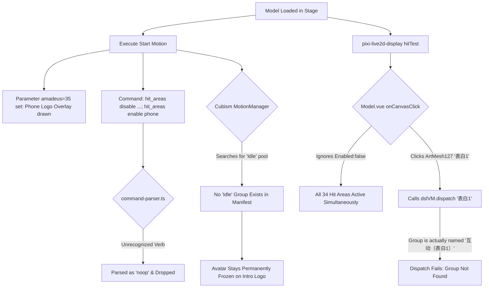
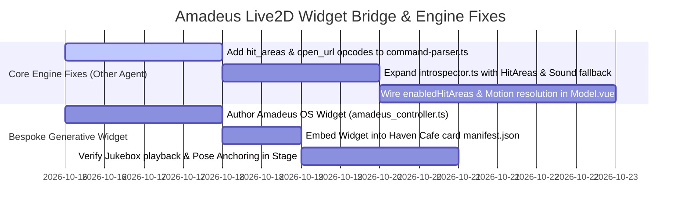

# Project Amadeus: Bespoke Live2D Generative UI Widget Bridge & Tactile Introspection Substrate
### 📱 Unlocking Creator-Scripted Live2D Models via Sandboxed Micro-Apps & Engine HitArea Introspection
**Specification & Architectural Design**

> **Status**: Approved Design / Ready for Implementation
> **Authors**: Richard Pinedo (@dasilva333 / azimuthal) & Antigravity Pair
> **Date**: 2026-10-15
> **Related Documents**:
> - [`docs/design-live2d-gimmick-deck-introspection.md`](./design-live2d-gimmick-deck-introspection.md) — Live2D tactile raycasts, Gimmick Deck, and DSL state machine introspection.
> - [`docs/design-generative-widgets-export-and-scoping.md`](./design-generative-widgets-export-and-scoping.md) — Export interface, scoping architecture (`global` vs `card`), and bundled starter presets.
> - [`docs/proposal-in-memory-sandboxes-and-edge-wasm.md`](./proposal-in-memory-sandboxes-and-edge-wasm.md) — Master proposal for sandboxed generative micro-frontends.
> - [`docs/research-live2d-special-sauce.md`](./research-live2d-special-sauce.md) — Empirical audit of creator-scripted Live2D packages.
> - [`docs/design-live2d-dsl-interpreter-spec.md`](./design-live2d-dsl-interpreter-spec.md) — Live2D DSL interpreter grammar, command pipeline, and reactive store.

---

## 1. Executive Summary & Proving Ground

Community Live2D creator packages (Wallpaper Engine, Bilibili, and game rips) frequently implement rich, self-contained interactive experiences. A prime benchmark is **Steam Workshop ID `2022880016`** (*命运石之门 - 牧濑红莉栖 / Steins;Gate Makise Kurisu*, authored by Bilibili creator `呦克里斯汀娜呦` based on the fan-favorite *Project Amadeus* mobile application).

While standard Cubism 3 models only contain passive mesh animations and an `"Idle"` motion pool, this model contains:
- **34 Interactive Tactile Hit Areas** simulating a smartphone operating system on the avatar's textures.
- **A 12-Track Steins;Gate BGM Jukebox** (~54 MB of MP3 audio tracks).
- **16 Voiced Interactive Dialogue Reactions** across 5 categories with probabilistic weights.
- **Custom Semicolon Command Pipelines** (`hit_areas enable/disable`, `stop_sound 0`, and `open_url`).

However, in AIRI's current runtime, loading this model encounters severe friction: the model freezes on the Amadeus phone call logo, the avatar's body never appears without manually pinning motions as idle, and the Gimmick Deck reports zero capabilities.

This project establishes the **Amadeus Live2D Widget Bridge**:
1. **The Core Engine Fixes**: Extends AIRI's Live2D parser and introspection engine to first-class support `hit_areas` states and `open_url`.
2. **The Bespoke Generative UI Widget ("Amadeus OS")**: Uses AIRI's Card-Scoped Generative UI micro-frontend subsystem (`scope: 'card'`) to render an authentic, glassmorphic smartphone controller that cleanly drives the model's jukebox, dialogue topics, and idle stance without canvas raycasting collisions.

```
┌──────────────────────────────────────┐  ┌──────────────────────────────────────────────┐
│        AIRI LIVE2D VIEWPORT          │  │     AMADEUS OS WIDGET (Card-Scoped Micro-App) │
│                                      │  ├──────────────────────────────────────────────┤
│                                      │  │  [📱 AMADEUS SYSTEM v3.04]      [🔴 Connected]│
│                                      │  │                                              │
│                                      │  │  ┌────────────────────────────────────────┐  │
│                                      │  │  │ 👤 Makise Kurisu (Amadeus Archive)     │  │
│                                      │  │  │ Status: Connected / Standby            │  │
│                                      │  │  └────────────────────────────────────────┘  │
│                                      │  │                                              │
│                                      │  │  🎵 STEINS;GATE JUKEBOX (12 Tracks)          │
│          [ Makise Kurisu ]           │  │  [ ▶ Amadeus ] [ ▶ Hacking to Gate ]          │
│          (Rendered in Stage)         │  │  [ ▶ Skyclad ] [ ▶ Gate of Steiner ] [ ⏹ Stop]│
│                                      │  │                                              │
│                                      │  │  💬 INTERACTION / VOICE TOPICS               │
│                                      │  │  [ ☕ Chitchat ]  [ 🔬 Lab Lore ]             │
│                                      │  │  [ 😳 Teasing ]   [ 💌 Confession ]           │
│                                      │  │                                              │
│                                      │  │  ⚙️ STAGE POSE CONTROLLER                    │
│                                      │  │  [ Lock Active Stance as Idle Loop ]         │
└──────────────────────────────────────┘  └──────────────────────────────────────────────┘
```

---

## 2. Root Cause Analysis: The 5 Engine Holes

Auditing [`2022880016.model3.json`](file:///Users/richardpinedo/Projects.nosync/airi/personal_airi/the-clockwork-roast-haven-cafe_card/models/steins_gate__makise_kurisu_/2022880016.model3.json) against AIRI's codebase reveals why the model cannot execute its intended flow out-of-the-box:



### 1. The Parser Opcode Hole (`command-parser.ts`)
In [`packages/live2d-runtime/src/dsl/command-parser.ts`](file:///Users/richardpinedo/Projects.nosync/airi/airi_dasilva333/packages/live2d-runtime/src/dsl/command-parser.ts#L53-L100), the tokenizer only recognizes:
`start_mtn`, `clear_exp`, `change_cos`, `motions`, `mouse_tracking`, `eye_blink`, `stop_sound`, `replace_tex`.
- `hit_areas enable/disable ...` falls into `default: return { kind: 'noop', raw }`.
- `open_url ...` falls into `default: return { kind: 'noop', raw }`.
As a result, menu-gating commands are discarded, and the state machine never transitions.

### 2. The HitArea Definition Mapping Hole (`Model.vue`)
In `2022880016.model3.json`, the creator decoupled the collider name from the motion group name:
```json
{
  "Name": "表白1",
  "Id": "ArtMesh127",
  "Motion": "互动（表白1）",
  "Enabled": false
}
```
In [`packages/stage-ui-live2d/src/components/scenes/live2d/Model.vue`](file:///Users/richardpinedo/Projects.nosync/airi/airi_dasilva333/packages/stage-ui-live2d/src/components/scenes/live2d/Model.vue#L1866-L1879), `hitTest()` returns `hitArea = "表白1"`, and the code executes:
```ts
dslVM?.dispatch(hitArea) // dispatches "表白1"
```
The VM looks for a motion group named `"表白1"`, which does not exist because the motion group is named `"互动（表白1）"`. The collider's `"Motion"` attribute is completely ignored.

### 3. The Initial Collider State Hole (`Enabled: false`)
Standard Cubism 3 does not define an `"Enabled"` boolean on hit areas. `pixi-live2d-display` treats every entry in `HitAreas` as immediately collision-active. All 34 hit-boxes float over each other at once, turning mouse clicks into random raycast collisions.

### 4. The Idle Pool Vacuum
Cubism relies on a conventional `"Idle"` motion group to run breathing and idle body swaying.
In `2022880016.model3.json`, there is no `"Idle"` group. Once `Start` (duration: 2.0s) completes, the engine has no fallback motion to schedule. Because `Start` animates parameter `amadeus` to 35 (the overlay logo), Kurisu stays frozen on the incoming call screen forever unless manually overridden.

### 5. The Introspection Engine Blindspot (`introspector.ts`)
In [`packages/stage-ui-live2d/src/interpreter/introspector.ts`](file:///Users/richardpinedo/Projects.nosync/airi/airi_dasilva333/packages/stage-ui-live2d/src/interpreter/introspector.ts#L151):
```ts
if (entry.Text && (entry.Sound || entry.NextMtn || entry.Expression)) {
  reactionsList.push(...)
}
```
The introspector requires an explicit `entry.Text` property. Models that embed raw voice acting (`Sound: "*.wav"`) without visual novel text subtitles are discarded, resulting in an empty Gimmick Deck. Furthermore, `HitAreas` are not captured in `Live2dCapabilities`.

---

## 3. Architecture Component A: The Bespoke Generative UI Widget ("Amadeus OS")

Rather than forcing users to click invisible or tiny colliders on a moving 2D canvas, we leverage the **Generative UI Sandbox Subsystem** ([`airi-generative-widgets`](file:///Users/richardpinedo/Projects.nosync/airi/.agents/skills/airi-generative-widgets/SKILL.md)) to provide a dedicated, first-class controller.

### 3.1 Card-Scoped Micro-Frontend Architecture
Per [`docs/design-generative-widgets-export-and-scoping.md`](./design-generative-widgets-export-and-scoping.md), this widget is scoped to `scope: 'card'` and bound to the Haven Cafe character card (`the-clockwork-roast-haven-cafe_card`). It mounts exclusively when Makise Kurisu / Haven Cafe is active.

```
personal_airi/the-clockwork-roast-haven-cafe_card/
├── card.json
├── manifest.json                  <-- declares widget in extensions.airi.widgets
└── widgets/
    └── amadeus_controller.ts      <-- sandboxed TypeScript component
```

### 3.2 Widget Runtime Implementation (`amadeus_controller.ts`)

```ts
import type { AiriWidgetContext } from './types/airi-widget'

export default function mount({ container, state, setState, onUpdate }: AiriWidgetContext) {
  // 1. Initial State
  const localState = {
    connected: state.connected ?? false,
    activeSong: state.activeSong ?? null,
    activeMotion: state.activeMotion ?? '互动（闲聊1）',
  }

  // 2. Build Glassmorphic Amadeus Smartphone DOM
  const root = document.createElement('div')
  root.className = 'p-4 rounded-2xl bg-neutral-950/90 border border-emerald-500/30 text-white font-sans text-xs select-none backdrop-blur-xl shadow-2xl'
  root.innerHTML = `
    <!-- Top Bar -->
    <div class="flex items-center justify-between border-b border-emerald-500/20 pb-2 mb-3">
      <div class="flex items-center gap-2">
        <span class="inline-block w-2 h-2 rounded-full ${localState.connected ? 'bg-emerald-400 animate-pulse' : 'bg-rose-500'}"></span>
        <span class="font-mono font-bold tracking-wider text-emerald-400">AMADEUS OS v3.04</span>
      </div>
      <span class="text-[10px] text-neutral-400 font-mono">1.048596%</span>
    </div>

    <!-- Call Status Card -->
    <div class="rounded-xl bg-neutral-900/80 border border-neutral-800 p-3 mb-3 flex items-center justify-between">
      <div>
        <div class="font-bold text-neutral-100">Makise Kurisu [Amadeus]</div>
        <div id="call-status" class="text-[10px] text-neutral-400 font-mono mt-0.5">
          ${localState.connected ? 'Connected (Voice Stream Active)' : 'Incoming Video Call...'}
        </div>
      </div>
      <button id="call-toggle-btn" class="px-3 py-1.5 rounded-lg text-xs font-bold transition-colors ${
        localState.connected
          ? 'bg-rose-500/20 text-rose-300 border border-rose-500/40 hover:bg-rose-500/30'
          : 'bg-emerald-500 text-neutral-950 font-extrabold hover:bg-emerald-400'
      }">
        ${localState.connected ? 'Disconnect' : 'Connect'}
      </button>
    </div>

    <!-- Steins;Gate BGM Jukebox -->
    <div class="mb-3">
      <div class="text-[10px] font-bold tracking-wider uppercase text-neutral-400 mb-1.5 flex items-center justify-between">
        <span>🎵 Amadeus Jukebox (12 Tracks)</span>
        <button id="stop-music-btn" class="text-[9px] text-neutral-500 hover:text-rose-400 font-mono">⏹ Stop</button>
      </div>
      <div class="grid grid-cols-2 gap-1.5 max-h-28 overflow-y-auto pr-1">
        <button data-track="音乐（amadeus）" class="track-btn px-2 py-1 rounded bg-neutral-900 border border-neutral-800 text-left truncate hover:border-emerald-500/50">▶ Amadeus (S;G 0 OP)</button>
        <button data-track="音乐（hacking）" class="track-btn px-2 py-1 rounded bg-neutral-900 border border-neutral-800 text-left truncate hover:border-emerald-500/50">▶ Hacking to the Gate</button>
        <button data-track="音乐（gate）" class="track-btn px-2 py-1 rounded bg-neutral-900 border border-neutral-800 text-left truncate hover:border-emerald-500/50">▶ Gate of Steiner</button>
        <button data-track="音乐（观测者）" class="track-btn px-2 py-1 rounded bg-neutral-900 border border-neutral-800 text-left truncate hover:border-emerald-500/50">▶ Skyclad Observer</button>
        <button data-track="音乐（another）" class="track-btn px-2 py-1 rounded bg-neutral-900 border border-neutral-800 text-left truncate hover:border-emerald-500/50">▶ Fatima (Another)</button>
        <button data-track="音乐（星之歌）" class="track-btn px-2 py-1 rounded bg-neutral-900 border border-neutral-800 text-left truncate hover:border-emerald-500/50">▶ Song of Stars</button>
      </div>
    </div>

    <!-- Interactive Dialogue Topics -->
    <div>
      <div class="text-[10px] font-bold tracking-wider uppercase text-neutral-400 mb-1.5">💬 Interactive Voice Topics</div>
      <div class="flex flex-wrap gap-1.5">
        <button data-group="互动（打招呼1）" class="topic-btn px-2.5 py-1 rounded-lg bg-neutral-900 border border-neutral-800 text-neutral-200 hover:border-emerald-500/40">👋 Greetings (4)</button>
        <button data-group="互动（闲聊1）" class="topic-btn px-2.5 py-1 rounded-lg bg-neutral-900 border border-neutral-800 text-neutral-200 hover:border-emerald-500/40">☕ Chitchat (4)</button>
        <button data-group="互动（kurisu1）" class="topic-btn px-2.5 py-1 rounded-lg bg-neutral-900 border border-neutral-800 text-neutral-200 hover:border-emerald-500/40">🔬 Kurisu Persona (3)</button>
        <button data-group="互动（调戏2）" class="topic-btn px-2.5 py-1 rounded-lg bg-neutral-900 border border-neutral-800 text-neutral-200 hover:border-emerald-500/40">😳 Teasing (3)</button>
        <button data-group="互动（表白1）" class="topic-btn px-2.5 py-1 rounded-lg bg-neutral-900 border border-neutral-800 text-neutral-200 hover:border-emerald-500/40">💌 Confession (2)</button>
      </div>
    </div>
  `
  container.appendChild(root)

  // 3. Stage & Model Dispatch Helper
  const stageChannel = new BroadcastChannel('airi-stores-live2d')

  function triggerModelMotion(groupName: string) {
    stageChannel.postMessage({
      type: 'dispatch-dsl',
      target: groupName,
      timestamp: Date.now(),
    })
  }

  // 4. Wire Connect / Disconnect Action
  root.querySelector('#call-toggle-btn')?.addEventListener('click', () => {
    localState.connected = !localState.connected
    setState({ connected: localState.connected })

    if (localState.connected) {
      // Execute phone call connection
      triggerModelMotion('phone')
      // Anchor the active conversational stance
      setTimeout(() => triggerModelMotion(localState.activeMotion), 800)
    }
    else {
      triggerModelMotion('Start')
      triggerModelMotion('stop_sound 0')
    }
  })

  // 5. Wire Jukebox Buttons
  root.querySelectorAll('.track-btn').forEach((btn) => {
    btn.addEventListener('click', (e) => {
      const track = (e.currentTarget as HTMLElement).dataset.track
      if (track) {
        triggerModelMotion(track)
        setState({ activeSong: track })
      }
    })
  })

  root.querySelector('#stop-music-btn')?.addEventListener('click', () => {
    triggerModelMotion('stop_sound 0')
    setState({ activeSong: null })
  })

  // 6. Wire Interactive Voice Lines
  root.querySelectorAll('.topic-btn').forEach((btn) => {
    btn.addEventListener('click', (e) => {
      const group = (e.currentTarget as HTMLElement).dataset.group
      if (group) {
        triggerModelMotion(group)
      }
    })
  })

  return () => {
    stageChannel.close()
    container.innerHTML = ''
  }
}
```

---

## 4. Architecture Component B: Core Engine Upgrades

While the Generative UI widget provides an immediate, zero-friction control surface, resolving the underlying engine holes ensures that all creator-scripted Live2D models run natively.

### 4.1 Parser Opcode Extensions (`packages/live2d-runtime`)
Update [`command-parser.ts`](file:///Users/richardpinedo/Projects.nosync/airi/airi_dasilva333/packages/live2d-runtime/src/dsl/command-parser.ts) to parse `hit_areas` and `open_url`:

```ts
// packages/live2d-runtime/src/dsl/types.ts
export type DslCommand
  = | { kind: 'start_mtn', target: MotionRef, raw: string }
    | { kind: 'clear_exp', raw: string }
    | { kind: 'change_cos', modelFile: string, index?: number, raw: string }
    | { kind: 'motions', enabled: boolean, target: MotionRef, raw: string }
    | { kind: 'mouse_tracking', enabled: boolean, raw: string }
    | { kind: 'eye_blink', enabled: boolean, raw: string }
    | { kind: 'stop_sound', channel: number, raw: string }
    | { kind: 'replace_tex', textureIndex: number, file: string, raw: string }
    | { kind: 'hit_areas', enabled: boolean, targets: string[], raw: string } // <-- NEW
    | { kind: 'open_url', url: string, raw: string } // <-- NEW
    | { kind: 'noop', raw: string }
```

In `command-parser.ts`:
```ts
case 'hit_areas': {
  const enabled = onOff(rest[0])
  const targetList = rest.slice(1).join(' ').split(',').map(s => s.trim()).filter(Boolean)
  return { kind: 'hit_areas', enabled, targets: targetList, raw }
}
case 'open_url': {
  const url = rest[0] ?? ''
  return { kind: 'open_url', url, raw }
}
```

### 4.2 Introspector Schema Expansion (`packages/stage-ui-live2d`)
In [`introspector.ts`](file:///Users/richardpinedo/Projects.nosync/airi/airi_dasilva333/packages/stage-ui-live2d/src/interpreter/introspector.ts):

1. **Extract HitAreas**:
   ```ts
   export interface GimmickHitArea {
     name: string
     id: string
     motion?: string
     enabled: boolean
   }
   ```
2. **Relax Reaction Text Constraints**:
   If `entry.Text` is absent but `entry.Sound` exists, generate a synthetic display label from the audio filename or motion group ID:
   ```ts
   const displayTitle = entry.Text
     ? String(entry.Text)
     : (entry.Sound ? `${groupName} (${entry.Sound.split('/').pop()})` : groupName)
   ```

### 4.3 Runtime HitArea Dispatching & Collider Gating (`Model.vue`)
In `Model.vue`:
1. Maintain a reactive `Set<string>` of enabled hit areas (`enabledHitAreas`).
2. When loading `model3.json`, initialize `enabledHitAreas` using `HitAreas[i].Enabled !== false`.
3. When `dslVM` executes a `hit_areas enable/disable` command:
   ```ts
   for (const target of cmd.targets) {
     if (cmd.enabled)
       enabledHitAreas.add(target)
     else enabledHitAreas.delete(target)
   }
   ```
4. In `onCanvasClick`, filter `model.hitTest()` against `enabledHitAreas`.
5. Resolve `targetMotion = hitAreaDef.Motion || hitArea.Name` before invoking `dslVM.dispatch(targetMotion)`.

---

## 5. Implementation Roadmap & Task Distribution



### Handoff Checklist for Peer Agent:
1. **`command-parser.ts`**: Implement `hit_areas <enable|disable> <targets...>` and `open_url <url>`.
2. **`introspector.ts`**: Parse `rawSettings.HitAreas` into `capabilities.hitAreas`; add audio-filename fallback for reactions missing `Text`.
3. **`Model.vue`**:
   - Honor initial `HitAreas[i].Enabled !== false`.
   - Update `enabledHitAreas` when `cmd.kind === 'hit_areas'` triggers.
   - Dispatch `hitArea.Motion` instead of `hitArea.Name`.
   - Provide fallback idle motion selection when no native `"Idle"` group exists in the manifest.
