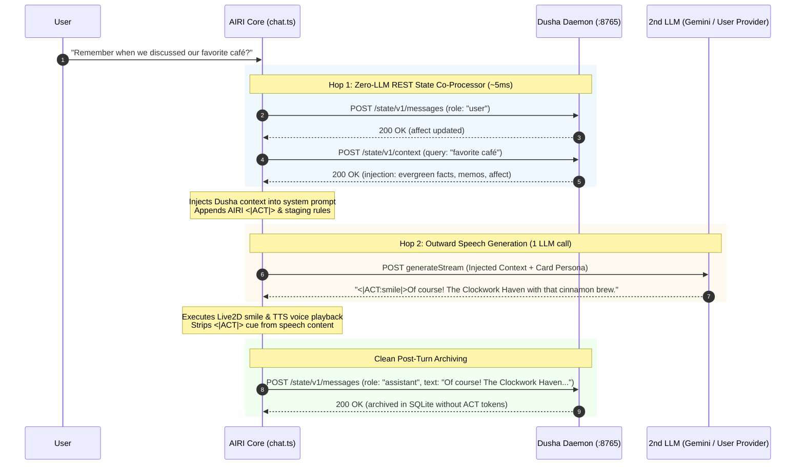
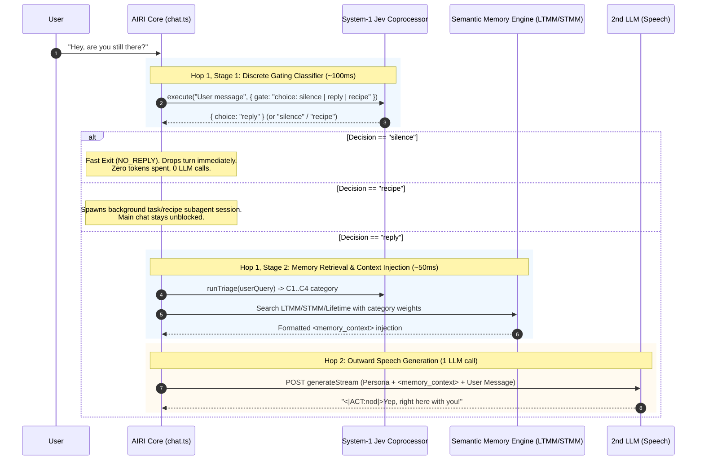

# Proposal: Two-Hop Cognition & Zero-LLM First-Hop Coprocessors (Dusha External Soul & Universe RAG++ System-1 Routing)

**Status:** Proposed Architecture & Integration Specification
**Author:** AIRI Engineering
**Date:** October 11, 2026 (Updated October 16, 2026)
**Target Systems:**
- `packages/stage-pages/src/pages/settings/airi-card/components/tabs/cognition/CognitionSubTabRouting.vue`
- `packages/stage-ui/src/stores/chat.ts` (Two-Hop Cognition Pipeline Seam)
- `packages/stage-ui/src/types/card.schema.ts` (AiriCognitionSchema)
- `packages/stage-ui/src/stores/modules/airi-card.ts`
- External Reference: [Somme4096/dusha](https://github.com/Somme4096/dusha)

---

## 1. Executive Summary & Motivation

### 1.1 The Multi-Harness Portability Problem & Heavy 1st-Hop Dilemma
Creators and companions in AIRI face two distinct architectural challenges in multi-hop cognition:
1. **Harness Silos**: Users who interact with companions across multiple environments (AIRI desktop, OpenCode, Discord bots, CLI harnesses) have memory and affect trapped in individual harness storage silos. Externalizing state via daemons like [Dusha](https://github.com/Somme4096/dusha) solves cross-harness amnesia.
2. **The "Two-LLM Hop 1" Bottleneck**: In earlier designs, cognitive routing options like **Universe RAG++** were conceived as chaining two full autoregressive LLMs (Hop 1: Deductive Coprocessor LLM generating a "Fact Dossier" $\rightarrow$ Hop 2: Outward Speech LLM). This introduced severe 2–3s latency spikes, doubled API token costs, fractured the prompt prefix cache, and added unnecessary complexity.

### 1.2 The Emerging "State-Context Standard" & Zero-LLM Coprocessors
The [Dusha](https://github.com/Somme4096/dusha) project establishes an open HTTP daemon pattern externalizing conversation messages, evergreen facts, active memos, and emotional affect.

Crucially, AIRI generalizes this pattern into the **"Zero-LLM 1st-Hop Co-Processor" Standard**:
- **Instead of spending an entire LLM turn in the 1st hop**, the 1st hop is redefined as an ultra-fast, non-autoregressive state enrichment and discrete decision stage.
- **Dusha Co-Processor (`dusha`)**: A zero-LLM REST step (~5ms local latency) querying `POST /state/v1/context` to enrich prompt context with external soul state.
- **Universe RAG++ System-1 Co-Processor (`universe_rag`)**: A zero-LLM native classification step (~100–150ms via ModernBERT / Jev) that gates discrete turns (`silence` | `reply` | `recipe`) and extracts relevant memory evidence into clean XML context injections.
- **2nd-Hop Vocal Speech**: A single outward LLM inference that consumes the injected context alongside AIRI's staging directives, Live2D/VRM `<|ACT|>` cues, and voice TTS.

---

## 2. Technical Archaeology & Code Reality Audit

### 2.1 Audit of Somme4096/dusha

#### A. The OpenAI Proxy Cannot Disable Upstream Calls
In `src/dusha/api_openai.py`:
```python
# Lines 99-105:
async def chat_completions(request: Request) -> Response:
    _upstream_base(request, cfg)  # Checks cfg.upstream.base_url
    body = await request.json()
    ...
    # Lines 142-154:
    response = await _upstream_request(request, cfg, "/chat/completions", body)
    if response.status_code < 400:
        ...
        await _ingest_assistant_response(...)
    return _passthrough_response(response)
```
- If `upstream.base_url` is empty, Dusha throws `HTTP 503 ("upstream.base_url is not configured")`.
- When configured, `/v1/chat/completions` **always** forwards to the upstream LLM and returns the upstream completion.
- In `src/dusha/config.py`, `UpstreamConfig` only provides `base_url`, `api_key_env`, and `timeout_seconds`. There is **no configuration flag** to suppress upstream forwarding or return dummy injected prompts.
- **Architectural Lesson**: Attempting to treat Dusha's `/v1/chat/completions` proxy as the 1st-hop LLM provider in a two-hop pipeline triggers **3 hops total** (Dusha $\rightarrow$ Upstream LLM $\rightarrow$ AIRI 2nd LLM), doubling token costs and latency.

#### B. The State API (`/state/v1/*`) is the Canonical Integration Surface
In `src/dusha/api_state.py`:
```python
# Lines 67-77:
@router.post("/state/v1/context", response_model=_schema.ContextResponse)
async def context(body: ContextInput) -> dict[str, Any]:
    return await _service_call(
        service.build_context,
        query=body.query,
        harness=body.harness,
        conversation_id=body.conversation_id,
        exclude_message_ids=set(body.exclude_message_ids),
        include_recent=body.include_recent,
        errors=(ContextBudgetError,),
    )
```
- `POST /state/v1/context` queries the local SQLite engine and memory plugins. It stores nothing, requires no upstream LLM, and costs 0 tokens.
- It returns an `injection` string composed of up to 5 structured tags:
  1. Identity prompt text
  2. `<evergreen_facts>`
  3. `<memory_context>`
  4. `<memo_notes>`
  5. `<companion_state>` (instructions, emotion values, session records)
- Complementary endpoints:
  - `POST /state/v1/messages`: Ingests user or assistant turns. User turns automatically evaluate and update companion affect vectors.
  - `GET /state/v1/affect`: Returns real-time affect coordinates (`base` and `mood`) with elapsed decay.

#### C. The Canonical Harness Pattern (`integrations/opencode_dusha`)
In `integrations/opencode_dusha/src/hooks.ts`:
1. On user message: Calls `POST /state/v1/messages` (`role: "user"`).
2. Before model dispatch: Calls `POST /state/v1/context` $\rightarrow$ pushes `injection` text into `system` messages.
3. Model completes: Calls `POST /state/v1/messages` (`role: "assistant"`).

---

### 2.2 Audit of AIRI's Cognition Pipeline

#### A. Two-Hop Cognition Seam in `packages/stage-ui/src/stores/chat.ts`
In `chat.ts` (lines 1510–1675):
```typescript
const airiExt = activeCard.value?.extensions?.airi as any
const cognitionConfig = airiExt?.modules?.cognition ?? airiExt?.cognition
const isCognitionEnabled = cognitionConfig?.enabled
  ?? (airiExt?.firstHopProcessor === 'nan0' || airiExt?.firstHopProcessor === 'local_nan0')

if (isCognitionEnabled && bridgedSteps === 1) {
  const firstHopProviderId = cognitionConfig?.provider || effectiveProviderId
  const firstHopModelId = cognitionConfig?.model || effectiveModel
  const processorMode = cognitionConfig?.processor || cognitionConfig?.firstHopProcessor || airiExt?.firstHopProcessor || 'none'
  ...
  if (processorMode === 'local_nan0' || processorMode === 'nan0') {
    // Nan0 Engine (Deliberation, Affect, Silence Gate)
  }
  else {
    // LLM Pass-through Mode
    const firstHopSystemPrompt = cognitionConfig.outputGuidance || `[COGNITIVE PROCESSOR]...`
    const firstHopResponse = await llmStore.generate(...)
    const rawOutput = firstHopResponse.text || ''
    newMessages = [
      ...system,
      { role: 'system', content: `[INTERNAL MONOLOGUE & ATTENTION DIRECTIVE]\n${rawOutput.trim()}` },
      ...afterSystem,
    ]
  }
}
```

#### B. The `<|ACT|>` Token & Tool Boundary
In `chat.ts` (lines 1883–1920) and `packages/stage-ui/src/utils/actor.ts`:
- AIRI separates raw stream output (`turnRawContent`, which contains `<|ACT:emotion=...|>` tokens, `<tool_call>`, and staging instructions) from user-facing spoken speech (`turnSpeechContent`).
- If raw completions are passed through Dusha's proxy, Dusha archives the `<|ACT|>` tokens into SQLite. When the companion is loaded into OpenCode, those tokens become visible junk.
- **AIRI Seam Advantage**: AIRI *already* possesses the clean, stripped speech text (`turnSpeechContent`). It can report pristine dialogue to Dusha while keeping motion tokens entirely local to AIRI.

---

## 3. Proposed Architecture: Zero-LLM 1st-Hop Co-Processors

### 3.1 The Co-Processor Paradigm
Instead of forcing every 1st-Hop to be an expensive autoregressive LLM inference call, AIRI formalizes the **1st-Hop Processor Taxonomy**:

| Processor ID | 1st-Hop Nature | 1st-Hop Operations | 2nd-Hop (Speech LLM) | Typical Latency | Cost / Tokens |
| :--- | :--- | :--- | :--- | :---: | :---: |
| `none` | Single-Hop Direct | Pass-through / raw prompt | Direct LLM character generation | 0ms | 0 |
| `universe_rag` | Zero-LLM Native Co-Processor | **Step 1:** System-1 Gating `(silence \| reply \| recipe)`<br/>**Step 2:** Semantic Memory Classifier $\rightarrow$ Dusha-style injection | Outward Speech LLM with `<memory_context>` injection | ~100–150ms | $0.00004 (Jev) |
| `dusha` | Zero-LLM External REST Co-Processor | `POST /state/v1/context` queries external daemon $\rightarrow$ Dusha soul injection | Outward Speech LLM with `<dusha_soul_context>` injection | ~5ms | 0 (Local SQLite) |
| `local_nan0` | Full Multi-Stage Cognitive Engine | Pre-classifier $\rightarrow$ Monologue LLM $\rightarrow$ Post-classifier | Outward Speech LLM with emotional state & monologue directives | ~1.5–3.0s | 2 full LLM turns |

---

### 3.2 Dusha External State Co-Processor Flow


---

### 3.3 Universe RAG++ System-1 Co-Processor Flow
In earlier designs, Universe RAG++ attempted to use a secondary LLM in Hop 1 to write an "Epistemic Dossier". In this refactored architecture, Hop 1 is completely freed from autoregressive LLM calls, operating as a 2-stage System-1 classifier:



---

## 4. UI Specification: `CognitionSubTabRouting.vue`

### 4.1 Dropdown Option
In `packages/stage-pages/src/pages/settings/airi-card/components/tabs/cognition/CognitionSubTabRouting.vue`:
```typescript
const processorOptions = [
  { value: 'none', label: 'None (Direct Proxy / Raw Prompt)' },
  { value: 'universe_rag', label: 'Universe RAG++ (Epistemic Memory & Grounding)' },
  { value: 'dusha', label: 'Dusha State Daemon (External Cross-Harness Soul & Memory)' },
  { value: 'local_nan0', label: 'Nan0 Local Engine (Emotional & Attention Rules)' },
]
```

### 4.2 Dynamic Form Behavior: Zero-LLM Adaptive Layout
A crucial UX flaw in earlier versions was that the form **always** rendered `1st LLM Provider (Thoughts)` and `1st LLM Model` even when the user selected a non-LLM processor.

Under the unified specification:

1. **When `firstHopProcessor === 'universe_rag'`**:
   - **HIDE** the 1st LLM Provider & Model dropdowns.
   - Render the **System-1 Jev Zero-LLM Banner**:
   ```html
   <div class="border border-emerald-200/80 rounded-xl bg-emerald-50/50 p-3.5 dark:border-emerald-900/40 dark:bg-emerald-950/20">
     <div class="flex items-center justify-between">
       <div class="flex items-center gap-2 text-xs font-semibold text-emerald-900 dark:text-emerald-200">
         <div i-lucide:zap class="text-emerald-500" />
         System-1 Jev Fast Co-Processor Active (~100ms)
       </div>
       <span class="rounded bg-emerald-500/10 px-2 py-0.5 text-[10px] font-medium text-emerald-600 dark:text-emerald-300">
         Zero 1st-Hop LLM Tokens
       </span>
     </div>
     <p class="text-[11px] text-emerald-700/80 dark:text-emerald-300/80 mt-1.5">
       Discrete gating (silence / reply / recipe) and memory semantic triage execute via your configured System-1 Coprocessor. Outward speech is generated entirely by the 2nd LLM below.
     </p>
   </div>
   ```

2. **When `firstHopProcessor === 'dusha'`**:
   - **HIDE** the 1st LLM Provider & Model dropdowns.
   - Render the **Dusha External Daemon Banner & Config Block**:
   ```html
   <div class="border border-blue-200/80 rounded-xl bg-blue-50/50 p-3.5 dark:border-blue-900/40 dark:bg-blue-950/20">
     <div class="flex items-center justify-between">
       <div class="flex items-center gap-2 text-xs font-semibold text-blue-900 dark:text-blue-200">
         <div i-lucide:sparkles class="text-blue-500" />
         External Dusha State Daemon Active (~5ms)
       </div>
       <span class="rounded bg-blue-500/10 px-2 py-0.5 text-[10px] font-medium text-blue-600 dark:text-blue-300">
         Zero 1st-Hop LLM Tokens
       </span>
     </div>
     <p class="text-[11px] text-blue-700/80 dark:text-blue-300/80 mt-1.5">
       Dusha enriches messages via its local HTTP API (http://127.0.0.1:8765). Cross-harness memories and affect vectors are injected without intermediate LLM cost.
     </p>
   </div>
   ```
   - Render Dusha connection inputs: `baseUrl`, `apiToken`, `harness` (default `airi`), `conversationId`.

3. **When `firstHopProcessor === 'local_nan0'`**:
   - **SHOW** the 1st LLM Provider & Model dropdowns.
   - Render the Nan0 Local Cognition Engine callout with link to the Affect & Triggers lab tabs.

---

## 5. Technical Implementation Details

### 5.1 Card Schema Extension (`packages/stage-ui/src/types/card.schema.ts`)
```typescript
export const AiriDushaConfigSchema = object({
  enabled: optional(boolean()),
  baseUrl: optional(string()),
  apiToken: optional(string()),
  harness: optional(string()),
  autoInject: optional(boolean()),
  archiveResponses: optional(boolean()),
})

export type AiriDushaConfig = InferOutput<typeof AiriDushaConfigSchema>
```

Add `'dusha'` to `firstHopProcessor` union:
```typescript
firstHopProcessor: optional(union([
  literal('none'),
  literal('local_nan0'),
  literal('universe_rag'),
  literal('dusha'),
])),
```

### 5.2 Seam Execution in `packages/stage-ui/src/stores/chat.ts`
Within the Two-Hop evaluation block:
```typescript
if (processorMode === 'dusha') {
  const dushaConfig = airiExt?.modules?.dusha ?? { baseUrl: 'http://127.0.0.1:8765', harness: 'airi' }
  const dushaBase = (dushaConfig.baseUrl || 'http://127.0.0.1:8765').replace(/\/+$/, '')
  const headers: Record<string, string> = { 'Content-Type': 'application/json' }
  if (dushaConfig.apiToken) {
    headers['X-Companion-Token'] = dushaConfig.apiToken
  }

  const userQuery = typeof sendingMessage === 'string' ? sendingMessage : getMsgStringContent(inferenceUserMessage?.content)

  try {
    // 1. Ingest User Turn (updates affect & cancels stale proactive events)
    await fetch(`${dushaBase}/state/v1/messages`, {
      method: 'POST',
      headers,
      body: JSON.stringify({
        harness: dushaConfig.harness || 'airi',
        conversation_id: sessionId,
        role: 'user',
        content: userQuery,
        external_id: `airi:${userMessageId}`,
      }),
    })

    // 2. Fetch Injected Context
    const contextRes = await fetch(`${dushaBase}/state/v1/context`, {
      method: 'POST',
      headers,
      body: JSON.stringify({
        harness: dushaConfig.harness || 'airi',
        conversation_id: sessionId,
        query: userQuery,
        include_recent: false,
      }),
    })

    if (contextRes.ok) {
      const data = await contextRes.json()
      if (data.injection?.trim()) {
        const personaIdx = newMessages.findIndex(m => m.role === 'system')
        const insertIdx = personaIdx >= 0 ? personaIdx + 1 : 0
        newMessages.splice(insertIdx, 0, {
          role: 'system',
          content: `[DUSHA_SOUL_CONTEXT]\n${data.injection.trim()}`,
        })
      }
    }
  }
  catch (err) {
    console.warn('[Dusha] State API request failed, proceeding with generation:', err)
  }
}
else if (processorMode === 'universe_rag') {
  const userQuery = typeof sendingMessage === 'string' ? sendingMessage : getMsgStringContent(inferenceUserMessage?.content)

  // 1. Stage 1: System-1 Discrete Gating (silence | reply | recipe)
  if (systemOneStore.configured) {
    const gateRes = await systemOneStore.execute(
      `User said: "${userQuery}"`,
      {
        action: {
          type: 'choice',
          instructions: 'Should the companion reply, stay silent (e.g. routine background/filler), or run a recipe?',
          criteria: {
            reply: 'User asked a question, made a greeting, or expects dialogue.',
            silence: 'Routine observation, self-talk, or statement not warranting speech.',
            recipe: 'User requested a structured multi-step automation task or SOP.',
          },
        },
      },
    )

    const decision = gateRes.answers?.action?.choice || 'reply'

    if (decision === 'silence') {
      // Fast Exit: Drop turn without invoking 2nd LLM (NO_REPLY)
      console.log('[Universe RAG++] System-1 elected silence. Dropping turn (0 LLM tokens).')
      return
    }

    if (decision === 'recipe') {
      // Delegate to autonomous recipe task loop
      console.log('[Universe RAG++] System-1 routed to recipe task loop.')
      await executeRecipeTaskSession({ userQuery })
      return
    }
  }

  // 2. Stage 2: Semantic Memory Retrieval & Context Extraction
  const memoryContext = await buildGroundingMessages({ query: userQuery, characterId: activeCard.value.id })
  if (memoryContext?.length) {
    newMessages.splice(insertIdx, 0, ...memoryContext)
  }
}
```

### 5.3 Post-Turn Archival Hook
On turn completion (after stream drains and `turnSpeechContent` is finalized):
```typescript
if (processorMode === 'dusha' && turnSpeechContent.trim()) {
  const dushaConfig = airiExt?.modules?.dusha ?? { baseUrl: 'http://127.0.0.1:8765', harness: 'airi' }
  const dushaBase = (dushaConfig.baseUrl || 'http://127.0.0.1:8765').replace(/\/+$/, '')
  const headers: Record<string, string> = { 'Content-Type': 'application/json' }
  if (dushaConfig.apiToken)
    headers['X-Companion-Token'] = dushaConfig.apiToken

  fetch(`${dushaBase}/state/v1/messages`, {
    method: 'POST',
    headers,
    body: JSON.stringify({
      harness: dushaConfig.harness || 'airi',
      conversation_id: sessionId,
      role: 'assistant',
      content: turnSpeechContent.trim(), // Pristine speech without <|ACT|> tokens
      external_id: `airi:resp:${turnLeaseId}`,
    }),
  }).catch(e => console.warn('[Dusha] Failed to archive assistant turn:', e))
}
```

---

## 6. Architectural Tradeoff Matrix

| Criterion | Direct Dusha Proxy (Single Hop) | Two-Hop with 1st-Hop LLM (Old Universe RAG++) | Dusha State Co-Processor (`dusha`) | System-1 Co-Processor (`universe_rag`) |
| :--- | :---: | :---: | :---: | :---: |
| **Total LLM Calls Per Turn** | 1 (Upstream) | 2 (1st LLM Dossier + 2nd LLM Speech) | **1 (2nd LLM only)** | **1 (2nd LLM only)** |
| **Network Latency Overhead** | None | ~1.5s–3.0s | **~5ms (Local REST)** | **~100–150ms (System 1)** |
| **Discrete Turn Gating** | ❌ None | ❌ None (Always speaks) | ❌ Handled by Dusha affect | **✅ Silence / Reply / Recipe** |
| **Prefix Cache Integrity** | Poor (Monologue drifts) | Broken by 1st-hop variance | **✅ 100% Stable Prefix** | **✅ 100% Stable Prefix** |
| **Cross-Harness Memory Purity** | ❌ Polluted with `<|ACT|>` cues | Internal to AIRI | **✅ 100% Clean Dialogue** | Local Flat Universe Keys |
| **AIRI Persona & Staging Control** | Limited to upstream | Fragmented across hops | **Full AIRI Staging Engine** | **Full AIRI Staging Engine** |
| **Configuration Complexity** | Upstream key required | 2 separate LLM configs | **Only AIRI 2nd LLM key** | **System 1 + 2nd LLM key** |

---

## 7. Next Steps & Implementation Milestones

1. **Card Schema Validation**: Add `dusha` and preserve `universe_rag` in `firstHopProcessor` in `card.schema.ts` and card stores.
2. **UI Updates (`CognitionSubTabRouting.vue`)**: Implement dynamic form hiding so `universe_rag` and `dusha` hide 1st LLM selectors and display their dedicated co-processor banners.
3. **Seam Integration (`packages/stage-ui/src/stores/chat.ts`)**: Wire `POST /state/v1/context` for Dusha and System-1 discrete gating + memory extraction for Universe RAG++.
4. **End-to-End Validation**: Verify fast-path silence drops (`NO_REPLY`), recipe auto-spawning, and clean Dusha SQLite message ingestion.
